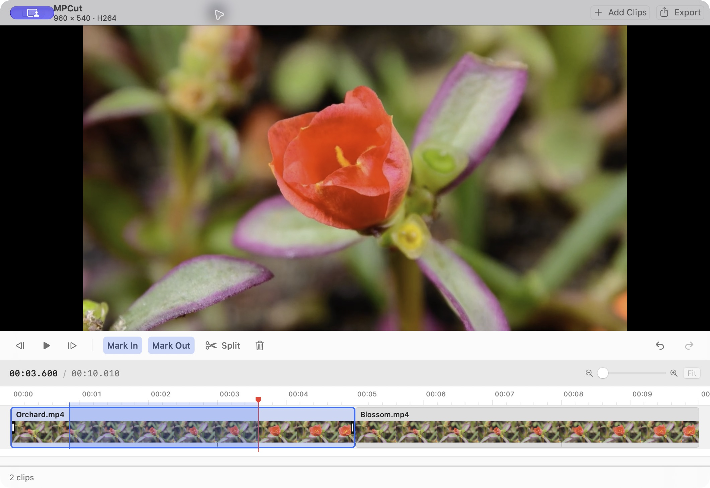

# MPCut

**A native macOS video and audio cutter for Apple Silicon.** Trim clips, remove sections, arrange matching recordings, and export a single edit or a batch of clips. The desktop app’s default video export mode, **Smart Trim**, copies compatible video packets and encodes only the cut edges that need it. Each export writes a new file and preserves your sources.

**[Download MPCut](https://github.com/andrewfitz/mpcut/releases/latest)** · [Full usage guide](docs/USAGE.md) · [Release notes](CHANGELOG.md)

> This README describes the **1.2.0 source build**. Check **MPCut → About MPCut** or run `mpcut --version` to identify your installed build. The downloads page lists the published versions. [Build from source](#build-from-source) · [Downloads](https://github.com/andrewfitz/mpcut/releases)

<picture>
  <source media="(prefers-color-scheme: dark)" srcset="docs/images/timeline-dark.jpg">
  
</picture>

## Capabilities and use cases

| What you want to do | How MPCut handles it |
| --- | --- |
| Assemble selects from a shoot | Trim, split, restore, delete, reorder, mark In/Out, and undo or redo on the timeline. Join matching files, repeat ranges with `export --order`, or enter a single source’s selects with `rearrange`. |
| Switch cameras during a recording | Save camera switches, sync offsets, soundtrack choices, and highlight ranges in a multicam project. Keep one microphone across picture switches or let the sound follow the camera. |
| Deliver one movie or a folder of clips | Export the retained sequence, queue marked ranges, or send a range list to `bulk`. Copy verified packets, Smart Trim the necessary video edges, or convert to hardware H.264, HEVC, or ProRes. Inspect the resolved edit before writing. |
| Review an interview and remove dead air | See the waveform beneath the filmstrip. Scan the chosen microphone, calibrate automatically or mark room tone, adjust dBFS/minimum duration/padding, jump between pauses, skip them on playback, audition joins, protect a pause, or queue the retained takes. |
| Edit a podcast or field recording | Work in the full waveform viewer and timeline. Inspect down to 10 ms, monitor the selected audio track, scrub, use J/K/L forward and reverse shuttle up to 8×, and export compatible audio without transcoding. |
| Extract tracks or return a processed mix | Select picture only, sound only, or an individual soundtrack. Copy AAC to M4A or compatible PCM to WAV. Use **Replace Source Audio** to put a matching external track back into a movie while retaining picture and other soundtracks. |
| Find shots or recurring camera angles | Detect hard cuts, navigate between them, label recurring views, and snap edits to keyframes, scenes, or silence edges. Export each scene separately or join matching views in source order. |
| Let an agent review pictures before cutting | Export small review JPEGs or full-resolution JPEGs at source times or the first frame/midpoint of scenes and non-silent ranges. Use the manifest’s exact source ranges to assemble the chosen shots. |
| Inspect exact timing and signal data | Read stream metadata, candidate containers, or calibrated pauses as JSON. Set a time window for frame, keyframe, audio packet, and waveform queries. |
| Reopen or share analysis between desktop and CLI | Save the editing index, scenes and view names, available thumbnails, waveforms, room-floor calibration, and silence results next to the media. Inspect the sidecar inventory or request a fresh scan. Choose sidecar reuse, snapping, playback, export presets, and pause defaults in Settings. |
| Preserve source presentation metadata | Preflight checks stream layout, codec and container compatibility. Supported workflows preserve rotation, pixel aspect ratio, variable frame timing, linked audio timing, alpha, and camera timecode. |
| Automate a repeatable edit | Discover every command with `help --json`, retrieve a single command’s inputs and outputs, reuse saved scene/silence reports, and dry-run edit JSON before exporting. Existing media destinations are protected. |

Use **File → New Project Window** (⌘N) to work on independent timelines and multicam projects side by side. Ordinary timelines and export queues are session-based. Multicam projects save the edit for reopening in the app or exporting from the CLI. Sidecars store source analysis for each recording. Save a CLI edit request if you need to replay an ordinary ordered assembly. [Multicam editing](docs/USAGE.md#edit-a-multicam-project) · [Usage and workflow examples](docs/USAGE.md)

## Install

MPCut requires **macOS 14 or later on Apple Silicon**. Download the arm64 ZIP, expand it, and move **MPCut.app** into Applications. To verify the download, put `SHA256SUMS.txt` next to the ZIP and run `shasum -a 256 -c SHA256SUMS.txt`. The published app is ad-hoc signed, so macOS may ask for approval on the first launch. [Release and downloads](https://github.com/andrewfitz/mpcut/releases/latest) · [Apple’s guide to opening downloaded apps](https://support.apple.com/en-us/102445)

The **Help** menu opens the bundled **MPCut User Guide** (⌘?) and **Release Notes** offline. **MPCut → About MPCut** also shows the installed version, documentation, credits, and a **Copy CLI Path** button.

## Edit on the timeline

1. **Add clips.** Use **Add Clips** or drop files onto the timeline. Drag matching recordings into playback order. For files with usable duration metadata, the viewer and timeline open while frame and audio indexing runs in the background. Visible thumbnails fill in progressively.
2. **Trim or remove footage.** Drag either handle to trim. Excluded footage stays visible and faded, and you can drag the handle back to restore it. Press **⌘B** to split at the playhead. To remove a section, press **I** at its start, **O** at its end, and **Delete**. Use **Esc** to clear the marks or **⌘Z** to undo an edit.
3. **Choose how to export.** Press **⌘E** to export the retained timeline as one file. To save several selections as separate files, mark each range with **I** and **O**, then press **⇧⌘A** to queue it. Open **Export Queue** with **⇧⌘E** to review the ranges, choose shared settings, and export numbered files.

The filmstrip supports landscape, portrait, and rotation-tagged footage. Use the zoom controls, **Fit**, and the Small/Large thumbnail button to adjust the timeline. The same size control is in **View → Large Timeline Thumbnails**. Click the time readout to jump to a specific time. Use **Snap To** beside the zoom controls to place edits on keyframes, scene cuts, or the edges of detected silence. Choose **Off** for ordinary frame editing. **Keyframes** checks whether the cut can be copied with its linked audio.

| Preview action | Shortcut |
| --- | --- |
| Play or pause | Space |
| Shuttle backward, pause, or shuttle forward | J / K / L |
| Move one frame | ← / → |
| Jump to a keyframe | Option–← / Option–→ |
| Jump to a scene after scanning | Shift–← / Shift–→ |
| Jump to a detected pause | Control–Option–← / → |

Repeated **J** or **L** presses step through 2×, 4×, and 8× shuttle speeds. Reverse shuttle plays the audio backward across the edited sequence. Dragging the playhead plays short audio previews in either direction. The toolbar speaker controls monitoring volume, mute, and scrub audio. The **File**, **View**, **Sequence**, and **Playback** menus expose the same actions. [Desktop controls and shortcuts](docs/USAGE.md#edit-a-sequence)

## Edit a multicam project

Choose **Add as Multicam…** beside **Add Clips** on the startup screen or in the **File** menu. Select the recordings, choose the opening angle and soundtrack, and adjust source offsets on the shared **Group** timeline. Choose a fixed master microphone, follow the active camera, or export without sound. Playback and scrubbing can start while exact source indexes load. Click a numbered camera button next to the mark controls or press **1–9** to switch at the playhead. Drag the switch marker or edit its picture and microphone in the inspector.

Mark and add group ranges to the **Assembly**. Drag the edges in its timeline lane to trim a range, drag its body to reorder it, or use the scissors button (⌘B) to split it at the playhead in **Group** or **Assembly** preview. Drag the timeline divider up to see more camera lanes. Use **Save Project** (⌘S) to save the edit as JSON and **Open Multicam Project…** to resume it. The **Export** inspector lets you check the current assembly or the whole group before export. [Desktop multicam editing](docs/USAGE.md#edit-a-multicam-project)

Use **Scan for Silence** to find pauses in the program soundtrack. The CLI can also report pauses or render the retained ranges from a saved project with `mpcut silence --project edit.multicam.json --json`. [Routed project audio examples](docs/USAGE.md#scan-and-shorten-routed-project-audio-from-the-cli)

## Edit audio or export individual tracks

Open a sound recording to edit it on the waveform timeline. Use the same In/Out marks, split, trim, reorder, pause detection, and export controls as for video. In the export sheet, choose **Video**, **Audio**, or both. Keeping only sound or picture uses stream copy. The available containers follow the selected codecs, such as WAV for compatible PCM or M4A for AAC.

To keep a movie’s picture and swap a soundtrack, choose **File → Replace Source Audio…** and select the processed audio file. MPCut checks duration, timing, and container compatibility before saving a working movie and applying it to every timeline cut from that source. The timeline identifies the replacement recording, and Undo restores the original. Use `mpcut help export --json` for the CLI options `--tracks`, `--audio-stream`, and `--replace-audio`. Use `mpcut waveform --json` for a signed amplitude envelope, or `mpcut inspect --audio-packets --json` for exact compressed audio packet timing. [Audio editing and track export](docs/USAGE.md#edit-audio-and-export-tracks)

## Find and shorten pauses

The waveform beneath the filmstrip fills in during a background scan. MPCut learns the quiet level for each recording and audio track. An isolated click in a quiet stretch counts as part of the pause. Choose **Scan for Silence** to see the estimated level and set the minimum duration. Click the pause count to reopen the controls. Jump to a pause, preview the proposed join, or skip pauses while watching. **Shorten Pauses** applies the cuts as one undoable edit. Export the joined movie with **⌘E**, or use **Queue Takes** to save separate clips. [Waveform and pause controls](docs/USAGE.md#find-and-shorten-pauses)

## Find camera cuts and recurring views

Click **Scan for Scenes** below the timeline or in the **Playback** menu. The scan runs in the background, and MPCut adds colored markers as it finds hard cuts. The scene buttons and Shift–arrow shortcuts activate after the scan when there are cuts or joins to navigate.

Similar shots share a view label such as **A**, **B**, or **AA**. Click the view name in the status bar to give matching shots a name like **Wide** or **Close-up**. Save an analysis sidecar to keep these names with the recording. View groups are estimates based on the picture. A digital punch-in can create a separate view.

Some scene cuts land on existing keyframes. In the multicam fixture, 11 of 12 detected cuts landed on a verified keyframe boundary. In *Tears of Steel*, 59 of 138 detected cuts did. Smart Trim copies video at safe edges. A zero `encodedDuration` in a CLI dry run means the entire video selection can be copied. The export checks audio boundaries separately. [Scene detection benchmark](docs/SCENE-BENCHMARK.md) · [Scene export workflows](#scan-and-export-scenes)

## Save analysis and review frames

The app and CLI automatically save and reuse matching analysis in a versioned SQLite sidecar such as `interview.mov.mpcut`. **File → Save Analysis Sidecars** also saves completed desktop analysis such as view names and available thumbnails. To inspect the cache inventory without updating it, run `mpcut sidecar --status --json interview.mov`. In **MPCut → Settings…** (⌘,), use **Analysis** for automatic sidecars and pause defaults, and **General** for timeline size, snapping, monitoring, and movie and JPEG export defaults. Pass `--no-sidecar` to bypass automatic sidecar reads and writes for a CLI invocation. [Save and reuse analysis](docs/USAGE.md#save-and-reuse-analysis)

**File → Export JPEG Frames…** exports the picture at the playhead or batches from scenes and non-silent ranges. Each folder includes a `manifest.json` with exact source times and frame-aligned edit bounds. With `mpcut frames --project`, an agent can compare every camera at the same group time before choosing a switch. [Review JPEGs](docs/USAGE.md#review-a-recording-with-jpegs) · [Compare camera angles](docs/USAGE.md#compare-all-angles-at-the-same-time)

## Export modes

| Mode | What it does |
| --- | --- |
| **Smart Trim** | Keeps the selected frame boundaries and copies compatible packets. It encodes the video edges that need it and reports how much footage will be copied and encoded. |
| **Lossless Copy** | Copies compatible video and audio without encoding. It can switch to another compatible container by remuxing. **Review Cuts** previews proposed changes when a cut is unsafe. |
| **Re-encode** | Converts the retained video with the Mac’s H.264, HEVC, or ProRes hardware encoder. Choose a quality preset and audio handling. |

For Re-encode, H.264 and HEVC can go in MP4, MOV, or MKV. ProRes can go in MOV or MKV. Audio options include Auto, Copy Original, AAC, and PCM where supported. Clear **Audio** to copy just the picture. Auto preserves original audio when the destination and edit support it. [Export settings and limits](docs/USAGE.md#choose-an-export-mode)

## Supported media

| Media | Editing behavior |
| --- | --- |
| Standalone PCM WAV/AIFF/CAF and AAC in M4A | Edit on the sample timeline, inspect the signed waveform, and copy the selected audio. |
| ALAC, FLAC, MP3, Opus and Vorbis audio | Inspect, analyze, and copy compatible streams. Available cuts depend on packet boundaries, decoder history, and the selected container. |
| ProRes MOV | Cut on video frames, including standard 422 and 4444 profiles. Linked PCM or AAC audio is checked at each boundary. |
| H.264 and HEVC in MOV or MP4 | Copy at verified boundaries. Smart Trim can hardware-encode the cut edges of compatible footage. |
| VP8, VP9, and AV1 in WebM | Copy compatible streams. Smart Trim can software-encode AV1 cut edges on Macs with hardware AV1 decoding. Discontinuous joins with Opus or Vorbis audio have limits. |
| Other local video | Probe MKV, MPEG-TS, AVI, MXF, and other formats. The streams, chosen ranges, and destination determine eligibility. |

Joining requires matching codec settings, dimensions, frame rate, color information, and audio layout. PCM and AAC audio embedded in supported video files can be preserved. MPCut supports standard ProRes 422 and 4444 families. Standalone audio recordings use the same timeline and CLI. RAW video, including ProRes RAW, is outside the supported inputs. [Detailed media support](docs/USAGE.md#media-support) · [Smart Trim requirements](docs/USAGE.md#cut-between-keyframes)

## Command line

The app includes the headless `mpcut` CLI for scripts and agents. With MPCut installed in Applications, set the path once for the examples below. From a source build, the executable is at `dist/MPCut.app/Contents/Helpers/mpcut`.

```sh
mpcut=/Applications/MPCut.app/Contents/Helpers/mpcut
"$mpcut" help --json
"$mpcut" help export --json
"$mpcut" inspect --json --keyframes input.mp4
"$mpcut" inspect --json --frames --from 2 --to 3 input.mp4
```

The installed CLI carries its own reference and offline user guide (`mpcut help manual`). `mpcut help --json` returns `commands`, indexed by name, and shared `conventions`. Use `mpcut help frames --json` for one command’s syntax, defaults, result fields, and examples, or `mpcut export --help` for text. The `export` and `bulk` topics also provide editable JSON request templates in `stdinExample`. **About MPCut** includes a **Copy CLI Path** button for installations outside Applications. [Agent quick start and I/O contract](docs/USAGE.md#use-the-cli-from-an-agent)

Use the inspection report’s top-level `file` as the source path for an edit. Use `--frames` for exact presentation timestamps and `--keyframes` for keyframe markers and verified start points. Times accept `MM:SS`, `HH:MM:SS`, decimal seconds, or exact fractions. JSON requests also accept the rational time objects returned by inspection. Each start is inclusive and each end is exclusive. Add `--dry-run --json` to validate cuts and inspect `copiedDuration` and `encodedDuration` before writing.

### Render a multicam JSON project in one command

Pass a project saved by MPCut or written by an agent directly to the CLI.

```sh
"$mpcut" export --project edits/interview.multicam.json --output interview.mov --json
```

Relative media paths inside the JSON resolve from the project’s directory. For example, `media/wide.mov` in this project resolves to `edits/media/wide.mov`. Relative `--project` and `--output` arguments resolve from the shell’s working directory. The command renders the saved assembly, or the entire group if the project omits `assembly`. It defaults to Smart Trim at the project’s exact times. Explicit video-only or audio-only exports use Lossless Copy.

To create a project, extract `projectTemplate` from `mpcut help multicam --json`, save it as JSON, and edit the filenames, offsets, soundtrack, and switches. Append `--dry-run` to the export command for an optional preflight that returns the resolved picture and audio ranges and actions without writing the movie. Use `mpcut inspect --project edits/interview.multicam.json --json` to check source coverage and group intervals. [Project schema and ordered range examples](docs/USAGE.md#inspect-and-export-a-project-from-the-cli)

### Rearrange ranges into one movie

```sh
"$mpcut" rearrange input.mp4 --output reordered.mp4 '23:01-26:12, 03:02-04:03'
```

The list sets playback order. `rearrange` uses Smart Trim and snaps to nearby valid boundaries by default. Use `--snap exact` to require the supplied times. For multiple recordings or programmatic edits, use `export` with repeated `--clip` flags or a JSON request. The optional one-based `order` list lets an agent reorder, repeat, or skip ranges.

```sh
"$mpcut" export --stdin --json --dry-run <<'JSON'
{
  "file": "input.mp4",
  "output": "assembly.mp4",
  "clips": [
    {"from": "10", "to": "15"},
    {"file": "alternate.mp4", "from": "3", "to": "8"},
    {"from": "40", "to": "45"}
  ],
  "order": [3, 1, 2]
}
JSON
```

Remove `--dry-run` to export. An explicit order defaults to Smart Trim. An ordinary `export` defaults to Lossless Copy. Use `--mode smart`, `--mode copy`, or `--mode encode` to choose explicitly. [CLI command and JSON reference](docs/USAGE.md#automate-an-export)

### Export multiple ranges as separate files

```sh
mkdir -p exports
"$mpcut" bulk --stdin --json <<'JSON'
{
  "file": "input.mp4",
  "outputDirectory": "exports",
  "ranges": [
    {"from": "00:10", "to": "00:15"},
    {"from": "01:00", "to": "01:10"}
  ]
}
JSON
```

`bulk` defaults to Smart Trim and writes one numbered file per range. It checks all ranges and destinations before writing and protects existing files. For one combined movie, use `rearrange` or `export`. [Bulk export options](docs/USAGE.md#export-several-timestamp-ranges-with-one-command)

### Detect silence or export a shortened movie

```sh
"$mpcut" silence --json --min-pause 2 --leave 0.4 --waveform 512 input.mov > pauses.json
"$mpcut" silence --stdin --json --mode smart --dry-run --output shortened.mov < pauses.json
"$mpcut" silence --stdin --json --mode smart --output shortened.mov < pauses.json
```

The report includes detected pauses, exact cut ranges, and optional waveform peaks. Choose `--mode copy` to shorten only where the retained streams can be copied. [CLI report fields and export options](docs/USAGE.md#analyze-silence-from-the-command-line)

### Scan and export scenes

```sh
"$mpcut" scenes --json montage.mp4 > scenes.json
mkdir -p by-scene by-view
"$mpcut" scenes --stdin --json --export-to by-scene < scenes.json
"$mpcut" scenes --stdin --json --export-to by-view --group-by view < scenes.json
```

The first command writes a JSON report with exact timestamps, scene numbers, and recurring-view labels. Both exports reuse the saved report. The first export writes one file per scene. The second joins matching scenes in source order, creating one movie per view. To scan and export in a single command, give `scenes` the source filename with `--export-to`. [Scene report fields and dry runs](docs/USAGE.md#detect-scenes-and-recurring-views)

### Re-encode with hardware

```sh
"$mpcut" export --json --mode encode --video hevc --quality balanced \
  --audio auto --output converted.mp4 --clip input.mp4
```

The output extension selects the container. Use `--video h264`, `hevc`, or `prores` and a quality preset that matches the codec. For a container change with compatible streams, use `--mode copy` to remux. JSON results go to standard output and progress goes to standard error. Errors return a nonzero exit status. [Codec, quality, and audio options](docs/USAGE.md#automate-an-export)

## Hardware and performance

MPCut uses VideoToolbox for hardware video decoding where supported, and Metal for filmstrip scaling and rotation. Compatible frames can go from the hardware decoder to the encoder directly. Lossless Copy and the copied parts of Smart Trim move compressed packets without decoding and encoding them again.

Video frame indexing, sidecar index serialization, and CLI frame and packet reports process batches across up to eight workers and merge them in source order. JPEG exports decode in timeline order and encode up to four pictures at once, with smaller batches for larger pictures. Long FLAC waveform and silence scans use frame-threaded decoding. When building a sidecar, the CLI can also analyze up to four independent audio tracks concurrently.

### Smart Trim performance

In a test on an M4 Max, the CLI assembled the ranges `23:01-26:12, 03:02-04:03` from a 2.5-hour file. It copied about **249 seconds of video** and encoded **2.68 seconds** at the edges.

In a separate FFmpeg benchmark on the same Mac, Smart Trim handled a 46-second selection **7.1× faster** than a full software AV1 re-encode. Both runs used the same AV1 encoder preset and copied the Opus audio from the same 1080 × 1920 WebM. Times are medians of three warm runs.

| Export | Elapsed time | Output size | Video encoded |
| --- | ---: | ---: | ---: |
| Smart Trim | 2.82 s | 8.38 MB | 6 s |
| Full re-encode | 20.02 s | 9.61 MB | 46 s |

The 1,200 copied pictures matched the source byte-for-byte. MPCut targets the source bitrate around each encoded edge. The 180 edge pictures averaged 92.9/100 VMAF against the decoded source, compared with 93.5 for the same pictures in the full re-encode. Results depend on the source and how much of the selection is safe to copy.

## Build from source

On an Apple Silicon Mac with the Xcode command-line tools, CMake, and pkg-config installed, run these commands from the repository root. The first build downloads and verifies the pinned FFmpeg and SVT-AV1 sources. The resulting bundle includes the native app, CLI, FFmpeg executable and required media libraries.

```sh
./scripts/build-app.sh
open dist/MPCut.app
```

Use `./scripts/build-app.sh /Applications` to install the source build there for the CLI examples above.

For development, install Homebrew FFmpeg and pkg-config, then run `swift test`. The integration suites also use Python 3 and the FFmpeg CLI tools. [Test commands and qualification limits](AUDIT.md#reproduce-the-release-checks)

## Verified on Apple Silicon

On an M4 Max Mac Studio, the GUI and CLI produced byte-identical files for the same three-source timeline edit. An export from three original ARRI ALEXA XT recordings retained all 769 expected ProRes packets and 1,476,480 stereo PCM sample frames in sequence. Tests also covered all six supported ProRes profiles, H.264 and HEVC splice boundaries, and hardware preview of VP9 and AV1 WebM.

A warm-cache benchmark assembled 6.49 GB of 4K ProRes 4444 footage in a median 4.40 s across three runs. A buffered read/write copy of the same number of bytes on the same internal SSD took 3.83 s. The benchmark reused one clip and did not force a storage flush. Performance varies with media, cache state, and storage.

The release includes FFmpeg notices, corresponding source, and the build recipe. The screenshot uses MDN’s flower sample. [FFmpeg notice](packaging/FFmpeg-Notice.txt) · [Sample footage](https://developer.mozilla.org/en-US/docs/Web/HTML/Reference/Elements/video#try_it)
