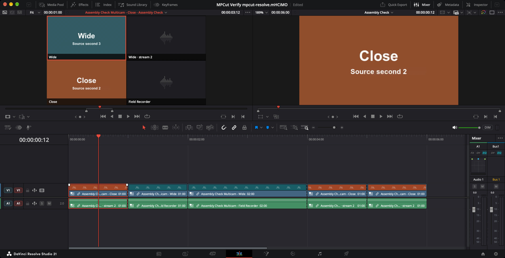
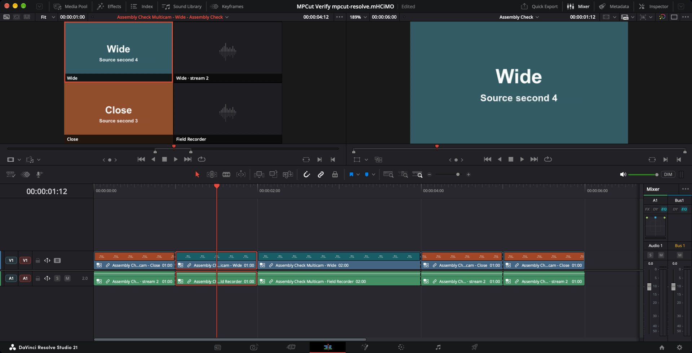
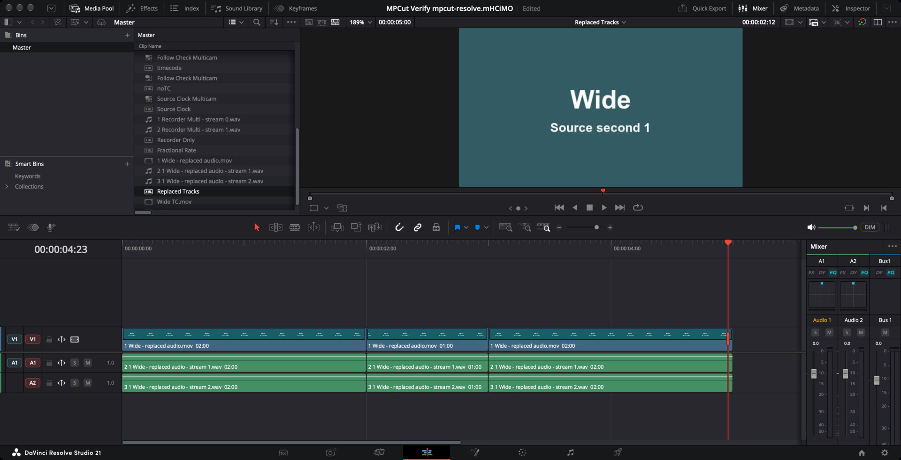
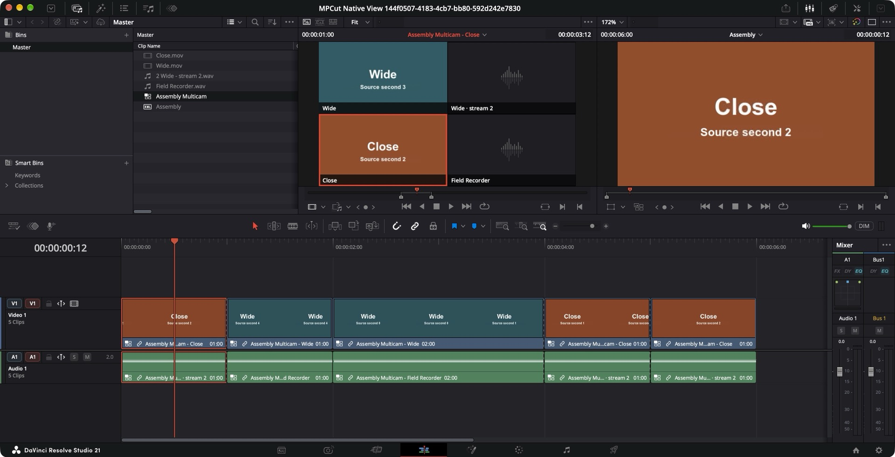
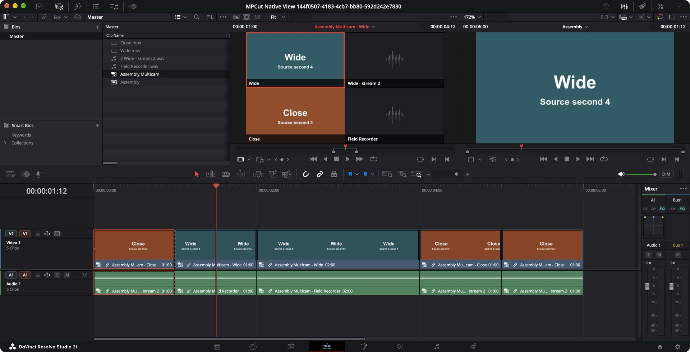
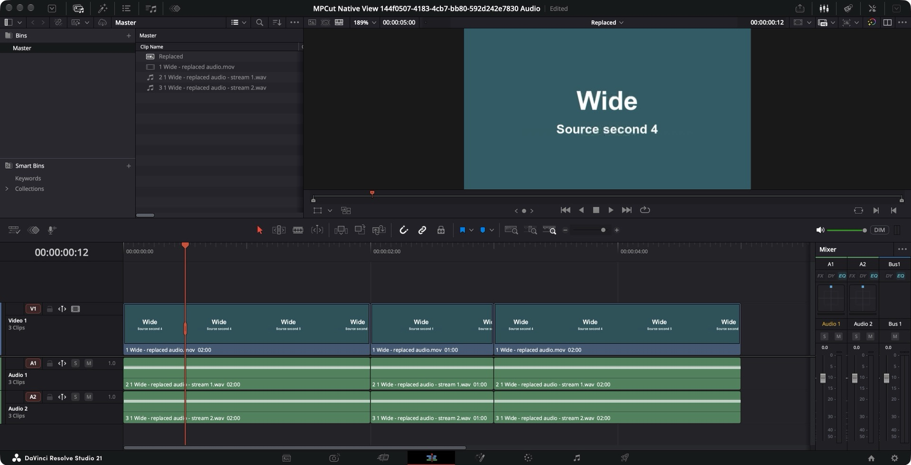

# Resolve export verification

Tested on macOS with DaVinci Resolve Studio 21.2.0.6. Both the packaged MPCut File menu and `mpcut project resolve import` imported the two-camera edit into a dedicated Resolve project. Resolve identified the video and audio timeline items as **Multicam**. Its Edit page showed both camera feeds and both sound sources.

## Multicam assembly

The 24 fps project used three assembly ranges in order: group seconds 3–5, 0–3 and 3–4. Close began one second after Wide. The field recorder carried a 660 Hz tone, and Wide’s second embedded audio stream carried a 1500 Hz tone. Source pictures displayed the camera name and source second.

| Resolve timeline frames | MPCut group time | Picture and source in | Routed audio |
| --- | --- | --- | --- |
| 0–23 | 3–4 s | Close at 2 s | Wide stream 2 |
| 24–47 | 4–5 s | Wide at 4 s | Field recorder |
| 48–95 | 0–2 s | Wide at 0 s | Field recorder |
| 96–119 | 2–3 s | Close at 1 s | Wide stream 2 |
| 120–143 | 3–4 s | Close at 2 s | Wide stream 2 |

Resolve reported five picture cuts and five audio cuts across 144 frames. Its exported timeline contained the one-second sync gap on the Close angle. A WAV rendered by Resolve measured 1500, 660, 660, 660, 1500 and 1500 Hz in successive seconds.





## Ordinary replacement tracks

The ordinary edit replaced stream 2 of a two-track movie, then assembled source seconds 4–6, 1–2 and 4–6. Resolve reported clip starts of 0, 48 and 72 frames on V1, A1 and A2. The output contained the retained 440 Hz tone and replacement 660 Hz tone. The original 1500 Hz tone measured zero in the rendered test window.



## Other timing checks

- Camera-follow audio with a negative camera offset and a one-hour source timecode produced tone in the selected camera intervals and silence in the intervals without a microphone.
- A 29.97 fps drop-frame source imported at 29.97 fps. Two segments began at source frames 1 and 60 and occupied 29 and 60 timeline frames.
- A Broadcast WAV with a one-hour time reference imported as an audio-only edit. A separate two-stream recorder edit populated A1 and A2.
- Eight repeated 60 ms cuts at 24 fps occupied 12 contiguous frames after rounding the cumulative edit boundaries.

The offline regression test creates temporary media and checks timecode, XML escaping, angle offsets, stream isolation and cumulative frame positions. Run `python3 Tests/Integration/resolve_export.py --cli .build/debug/mpcut` with FFmpeg available.

## Native project and timeline archives

The CLI wrote a multicam assembly and an ordinary replacement-track edit to both `.drp` and `.drt`, then imported all four archives into new `.cut` files using Resolve Studio 21.2. The native writer reopens each staged archive in Resolve before publication and compares track counts, item names and types, clip positions, source offsets and timeline duration. Each operation restored the previously open project.

The reopened multicam DRP showed the same five picture and audio intervals listed above. Both native imports recovered the one-second Close camera offset, the selected microphones and the repeated source range. The recovered group ends at second 5, the last group time used in the program. MPCut warned about the unused portion of the original eight-second group before export.

An angle can carry several recordings with a gap between them. Selecting that angle over the gap leaves the picture black while its independent program microphone continues. The assembled timeline can repeat a group range and choose a different camera on one occurrence. The native regression checks both archive formats for linked recordings and their coverage, repeated ranges, occurrence-specific camera choices and independent audio. Resolve assigns its own angle identifiers and may reorder the angles. MPCut reconstructs switch markers and assembly items from Resolve’s timeline cuts on import.

A Resolve 21.2 render of this FCPXML layout had black frames in both selected gap intervals. The independent microphone had the same measured level across the first gap and adjacent cuts. The second gap used a video-only selection and rendered silent.





Both replacement-track archives contained the ranges 4–6, 1–2 and 4–6 seconds. The reopened DRT displayed three clips each on V1, A1 and A2. The generated audio files for both archives measured 440 Hz on stream 1 and 660 Hz on stream 2. The former 1500 Hz tone was absent from the replacement stream. When converting back, MPCut reported that it used the source movie's embedded sound in place of separate timeline audio components. The source movie in this test already contained the replacement.



With a saved project open in Resolve and local external scripting enabled, run the native regression:

```sh
swift build --product mpcut
python3 Tests/Integration/resolve_native.py --cli .build/debug/mpcut
```

The regression generates source media, writes both native formats, checks strict-mode reporting and reads both archives back through the CLI. Native import requires `--allow-loss` because the timeline interchange cannot certify Resolve-only effects, grades, Fairlight processing or project settings. For projects with multiple timelines, export the desired timeline as a DRT in Resolve.

A direct CLI conversion from the replacement-track DRP to a Premiere Pro 27 project, followed by conversion back to MPCut, recovered source ranges 4–6, 1–2 and 4–6 seconds. All three occurrences linked to the working movie containing both audio streams.

The native writer also checks the reopened archive against the generated timeline's frame rate, frame count, raster, and picture/audio cut boundaries. A 7 fps fixture was silently interpreted as 72 fps by Resolve 21.2. MPCut now rejects that conversion. Resolve clamped a 160×90 fixture to 256×256 while preserving the edit timing. That raster change requires explicit loss approval. Native archives retain the playable replacement recording, while MPCut-specific original-media references, preview-track choices, and replacement track labels require loss approval. Direct timeline handoffs check the newly added timeline against the XML and identify any changed timing or raster. If verification fails, the added timeline remains in the current project and the generated XML stays available. Direct handoffs and native conversions share a host lock so a handoff cannot add a user's timeline to a temporary archive-verification project.
