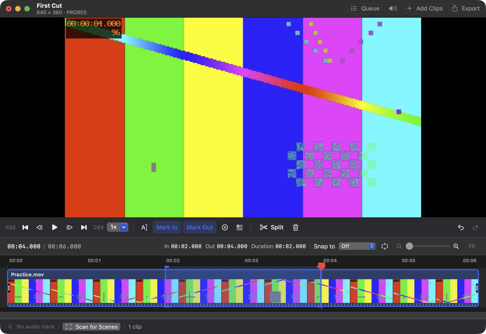
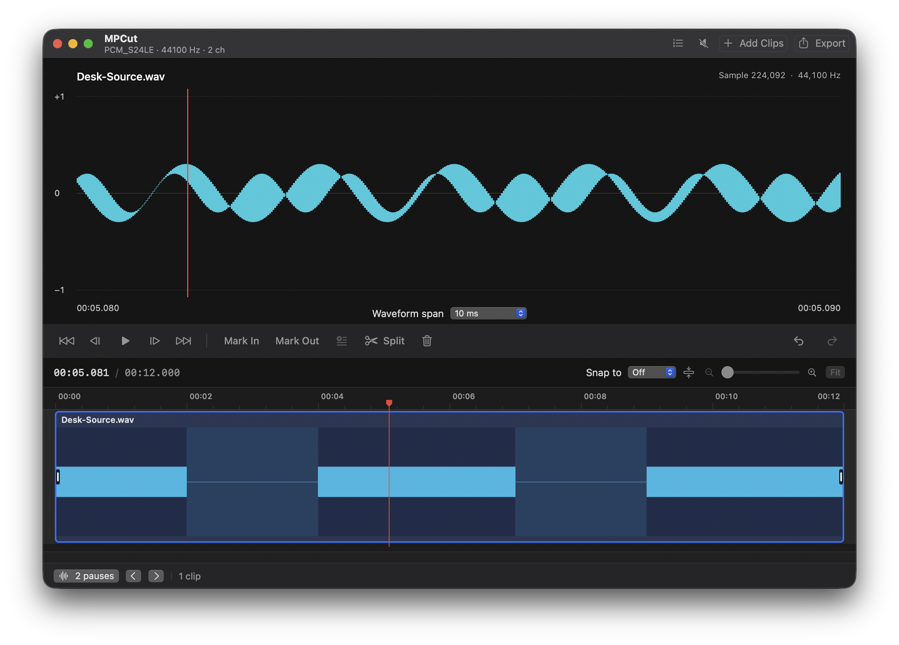

# Using MPCut 1.2.0

Choose **Help → MPCut User Guide** (⌘?) to open this guide. The **Help** menu also has the **MPCut Agent Guide** and **Release Notes**. Open **MPCut → About MPCut** for the installed version, credits, and the path to the command-line tool.

Jump to [working with several windows](#work-with-several-editor-windows), [multicam editing](#edit-a-multicam-project), [working with still images](#work-with-still-images), [shortening pauses](#find-and-shorten-pauses), [audio editing and track export](#edit-audio-and-export-tracks), [CLI automation](#use-the-cli-from-an-agent), [settings](#set-editing-and-export-defaults), or [reviewing footage with JPEGs](#review-a-recording-with-jpegs).

## Make your first cut

Remove the middle of a recording and export the two ends as one movie. The example uses a six-second clip and removes seconds 2 through 4. You can follow along with your own recording and choose different times.

1. Choose **File → Add Clips…** (⌘O), select a movie, then click **Add**. Wait for indexing to finish so the timeline is ready to edit.
2. Click the ruler where the unwanted section begins and click **Mark In** (I). Move to the end of the section and click **Mark Out** (O). For an exact time, choose **Playback → Go to Time…**, type the time in seconds, and press Return. Check the **In**, **Out**, and **Duration** readouts before deleting. Press Esc to clear the marks and try again.

   

3. Press **Delete**. The two retained pieces now meet at the cut. In the example, the timeline runs four seconds. Click the ruler just before the join and press **Space** to preview it. Press **⌘Z** if you want to change the cut.

   

4. Choose **File → Save Project** (⌘S) to keep the editable timeline as a `.cut` file. Keep the source recording available when you reopen it.
5. Choose **File → Export Media…** (⌘E) to create the movie. For the ProRes example, choose **Lossless Copy** and **MOV**. For other recordings, review the [export modes](#choose-an-export-mode). Choose a new filename and click **Export**. After the export finishes, **File → Show Last Export in Finder** reveals the result.

To join recordings, add compatible clips and drag them into playback order. Drag a clip edge to shorten it. To write several marked sections as individual files, use the session’s [export queue](#export-several-ranges-from-the-timeline).

## Work with still images

Mark a range and choose **Sequence → Replace Picture…** to show a photo while the soundtrack continues. Choose **Sequence → Insert Still…** at the playhead to add a card with its own duration and silence. Open **Stills** below the timeline to change framing, remove a placement, or relink an image. For a saved project, run `mpcut help still` for the CLI operations. [Still image guide](STILL-IMAGES.md)

## Apply CSV cut points to a clip

Drop one UTF-8 `.csv` file directly onto a clip in the sequence timeline. The outline shows which occurrence will be edited. Dropping the file on the viewer edits the clip at the playhead. You can also select a clip and choose **Sequence → Apply CSV to Selected Clip…**. Undo (⌘Z) restores the whole edit in one step.

To split at 2 and 5 seconds and keep all three pieces, use one timestamp per row under an optional `time` header. Points must increase and fall inside the clip.

To remove gaps, rearrange sections, or repeat a take, write one keep range per row. This example plays seconds 5–8, then 0–2, then 5–8 again.

```csv
from,to
5,8
0,2
5,8
```

A CSV file can contain up to 64 MiB. An edit can expand CSV rows and repeats into up to 100,000 pieces. The range header is optional. `start,end` also works. Every start is inclusive and every end is exclusive. Both CSV layouts accept seconds, clock times such as `01:02.5`, and exact fractions such as `1001/30000`. Zero means the beginning of the clip as trimmed. Export uses the normal boundary rules for the chosen mode.

In the CLI, attach `--csv` to its `--clip`. Use `--from` and `--to` on that clip to set the scope first. Add `--dry-run --json` to inspect the resolved edit.

```sh
mpcut export --clip interview.mov --csv selects.csv --mode smart --snap nearest --output selects.mov
```

## Pass lists to CLI commands

Use UTF-8 CSV or JSON list files anywhere the CLI accepts an ordered list. Relative media paths use the command’s working directory, just as they do on the command line.

| Command and parameter | CSV rows | JSON array example |
| --- | --- | --- |
| `rearrange SOURCE --ranges LIST`, `bulk SOURCE --ranges LIST`, `export --clip SOURCE --ranges LIST` | `from,to` keep ranges, or one `time` per split point | `[{"from":"5","to":"8"},{"from":"0","to":"2"}]` or `[2,5]` |
| `export --clips LIST`, `resolve --clips LIST` | One path per row, or a header beginning with `file` or `project` and optional `from,to` columns | `["intro.mov","talk.mov"]` or `[{"file":"talk.mov","from":"1/2","to":"3"}]` |
| `export --order-file LIST` | One clip number per row, optional `order` header | `[2,1,2]` |
| `frames --at-file LIST` | One timestamp per row, optional `time` header | `[0,"1/2","00:03"]` |
| `sidecar --only-file LIST` | One section per row, optional `section` header | `["index","audio"]` |
| `scenes --export-to DIR --scenes-file LIST` | Header `start,end,view`, optional `number` | `[{"start":0,"end":1,"view":1}]` |
| `silence SOURCE --pauses-file LIST` or `silence --input REPORT.json --pauses-file LIST` | `from,to` explicit, non-overlapping pause intervals in source order | `[{"from":"1","to":"2"}]` |

`rearrange` also accepts the list path in place of its inline range argument. Likewise, `--at`, `--order`, and `--only` accept a CSV or JSON path directly. Quote CSV paths containing commas or quotes using standard CSV quoting. JSON list files accept numbers with up to 38 significant digits. For frame-exact times, use a quoted fraction such as `"1001/24000"`.

```sh
mpcut rearrange interview.mov --ranges selects.json --output highlights.mov
mpcut bulk interview.mov --ranges selects.csv --output clips --dry-run
mpcut export --clips sources.csv --order-file playback.json --output assembly.mov
```

`rearrange` joins the retained pieces into one movie. `bulk` writes one numbered file per piece to an existing directory. For complete requests and saved analysis reports, `export`, `bulk`, `resolve`, `scenes`, and `silence` accept `--input FILE.json` with the same JSON object as `--stdin`.

## Select and edit a timeline range

Press **R** or click the I-beam in the transport bar. Drag from one edge of the range to the other. You can drag in either direction and across clip boundaries. Click once to collapse the highlight, or press **A** to return to the pointer for moving and trimming clips.

| With a range highlighted | Action |
| --- | --- |
| **⌘B** or the scissors | Split at both edges in one undoable edit. Existing cuts inside the range stay in place. Split is available when at least one edge falls inside a clip. |
| **⌥⌘E** or **Export Selection** | Open export options for just the highlighted material. Splitting first is optional. |
| **Delete** | Remove the highlighted time and close the gap. **⌘Z** restores it. |

In multicam, drag on the **Assembly** row to target one occurrence, even when footage appears more than once. A selection on the **Group** lanes uses camera-group time. Splitting or deleting it affects every retained occurrence of that interval. Exporting it produces the selected group interval once. Multicam projects require at least one assembly item.

## Work with several editor windows

Choose **File → New Project Window** (⌘N) for an empty editor. Each window has its own timeline, playhead and edit history. **⌘O** adds recordings to the active window. **Add as Multicam…** uses an empty editor or opens a separate window if the current timeline has clips. Choose **File → Open MPCut Project…** (⇧⌘O) to open a saved project. If it is already open, MPCut brings that window forward.

Windows opening the same recording can share one background index scan. MPCut also keeps a bounded in-memory cache of completed indexes for the current app session, including when automatic sidecars are off. It checks the file identity before reusing an index.

**⌘W** closes the active window. MPCut asks about unsaved timeline edits when you close their window. **⌘S** saves the project. **File → Save Analysis Sidecars** writes completed analysis to each recording’s `.cutdb` cache.

MPCut writes an untitled `.cut` draft when you add clips. Each window keeps its own draft in the macOS Autosave Information directory. **⌘S** writes the project and its retained history to the location you choose, then removes the draft. If the app stops unexpectedly, choose **File → Recover Untitled Project…** and select the last edit time. Saving the recovered project lets you give it a name. If macOS closes a window without completing its save prompt, you can also recover unsaved edits to a named project here. The saved original stays at its last explicit save.

Choose **View → Show Video Monitor** to review the active project in a video-only window. Drag it to another display or use its full-screen control.

Use **File → Import External Project…** to convert an editor project into a new `.cut` and open it. **File → Export Project** writes the current edit in the chosen format. During conversion, **File → Cancel Project Conversion** requests cancellation. MPCut waits for the active host operation to finish cleanup. Ordinary timelines use the desktop editor’s source compatibility checks when opened. [Converter requirements](../README.md#convert-projects) · [Project schema and examples](CUT-FORMAT.md)

## Edit a sequence

Press **⌘O** to add clips, or drop them where you want them on the timeline. Click the ruler to move the playhead. Drag a clip to move it, or drag either edge to trim it. Narrow thumbnails crop the picture to fit, including portrait and rotated footage.

Faded frames fall outside the edit. Drag the handle back over them to restore them, or press Esc during a drag to cancel. The ruler shows the duration you’ve kept. The time beside the handle shows where you are in the source. The left handle previews the first frame you’ll keep. The right handle previews the last frame and shows the time just after it.

Handles move one frame at a time by default. Use **Snap To** beside the zoom slider to line up later edits with **Keyframes** (verified copy points), **Scenes** (detected scene changes), or **Silence** (pause boundaries on the selected track, rounded to a video frame). Start a scene scan with **Playback → Scan for Scenes**. Choosing **Silence** starts a scan if needed. The playhead snaps within eight screen points of a matching boundary, including clip joins. Choose **Off** to return to frame editing.

For a menu-driven trim, select a clip, position the playhead inside it, and choose **Sequence → Trim Selected Clip → Trim Start to Playhead** or **Trim End to Playhead**. The same submenu can **Restore Original Start** or **Restore Original End**. To reorder the selected clip by one position, choose **Sequence → Move Selected Clip Earlier** or **Move Selected Clip Later**.

You can watch or scrub a video while MPCut indexes it. If the file header includes a duration, the first frame fills the empty timeline. Up to ten frames from across the recording appear as they load. **Sampled audio** shows levels from short excerpts of the track you’re monitoring. As indexing finishes, MPCut fills in the detailed filmstrip and waveform and enables frame stepping, trimming, and export. To stop the import, click **Cancel** in the status bar.

Drag the playhead to hear the audio at that point. Drag left to hear it in reverse. Release to stop. Use **Preview Audio** (the speaker in the toolbar) to adjust the volume, mute playback, or turn off **Play audio while scrubbing**. Choose which audio to export in the export sheet.

Beside Play, the inner arrows step one frame, the next pair jump by keyframe, and the outer pair jump by scene. Click **Scan for Scenes** below the timeline or choose **Playback → Scan for Scenes** to start a background scan. Colored ticks and view labels appear as MPCut finds cuts. Scene navigation stays disabled until the scan finishes and there are cuts or joins to jump between. Then use the outer buttons or **Shift–← / Shift–→**. You can continue editing or cancel from the status bar.

After analysis, the status bar shows the current scene and estimated recurring view within the source. Matching shots get the same lettered label and color. Click the status label or choose **Playback → Rename Current View** to apply a name such as “Wide” to every matching shot in the current session. A blank name restores the default. A camera punch-in can form a separate view. Camera movement, changed lighting and similar compositions can affect grouping. Gradual dissolves and single-frame flashes are outside the hard-cut target.

Choose **Edit → Project History…** (⇧⌘Y) to see each retained edit in order. The current state has a checkmark. Select an earlier or later state and choose **Restore State** to jump there. Undo and Redo also work after reopening the saved `.cut` project. Making a new edit after undoing replaces the remaining redo steps.

In **Settings → General → Project history**, set **Maximum steps** to a value from 0 to 500. The default is 50 steps shared between undo and redo for each project. Lowering the limit trims open projects immediately and takes effect in a named project file the next time you save it. At 0, MPCut records no timeline history.

**Clear Marks** beside Mark Out clears both marks. Hover over Undo or Redo to see which edit it will affect. Wheel up over the timeline to zoom in and down to zoom out. Option-wheel also zooms. Hold Command and scroll to pan horizontally using your macOS scrolling direction. Horizontal trackpad swipes pan directly. These gestures also work over the multicam lanes. Use the magnifying-glass buttons beside the zoom slider to change the timeline scale, or **Fit** to see the full sequence. The thumbnail-size button beside **Snap To** switches between Small and Large. The same setting is in **View → Large Timeline Thumbnails**.

Press **J** to play backward, **K** to pause, and **L** to play forward. Repeating J or L increases the speed to 2×, 4× and 8×. Changing direction starts at 1×. During reverse playback you hear the source audio backward, following the current order and trims as the playhead crosses each join. The speaker’s volume and mute controls apply in both directions. **Play audio while scrubbing** controls the short previews you hear when dragging the playhead.

| Action | Shortcut |
| --- | --- |
| Play or pause | Space |
| Shuttle backward / pause / shuttle forward | J / K / L |
| Slower / faster / normal playback | [ / ] / Backslash |
| Zoom timeline out / in | − / = or ⌘− / ⌘= |
| Toggle fit / previous zoom | Shift-Z |
| Go to timeline start / end | Home / End |
| Step one frame | ← / → |
| Jump by keyframe | Option–← / Option–→ |
| Jump by scene | Shift–← / Shift–→ |
| Jump to the previous / next detected pause | Control–Option–← / → |
| Mark the beginning and end of a range | I / O |
| Split at the playhead | ⌘B |
| Remove the marked range or selected clip | Delete |
| Undo / redo | ⌘Z / ⇧⌘Z |
| Project history | ⇧⌘Y |
| Clear marks | ⌥X or Esc |
| Save project | ⌘S |
| Open Settings | ⌘, |
| Export media | ⌘E |
| Add marked range to export queue | ⇧⌘A |
| Open export queue | ⇧⌘E |

## Edit a multicam project

1. Click **Add as Multicam…** on the blank start screen or choose **File → Add as Multicam…**. Select at least one camera recording and any separate audio recordings. In **Set Up Multicam**, check the source order, opening camera, and soundtrack, then click **Create Multicam**. The opening camera sets the reference and the initial group duration. To add recordings later, use **Add Sources** in the toolbar or press **⌘O**. In **Sources**, you can relink recordings, rename and reorder angles, assign microphones, enter exact offsets, nudge camera sources by a frame or separate audio sources by a sample, and change the group end.
2. In **Group** preview, click the ruler or a filmstrip to seek. Click a numbered camera button next to the mark controls, click **Take** in a camera lane, or press **1–9** to switch at the playhead. The camera buttons highlight the on-air camera, and the audio lane shows the selected soundtrack. Drag a switch marker to change its time. Select it to edit its picture or microphone in **Switch**, or delete it to extend the previous selection. The opening switch stays at zero.
3. Use **Mark In**, **Mark Out**, and **Add to Assembly** to build an **Assembly**. Open the **Assembly** inspector or choose **Assembly** preview to show the assembly timeline. Click a range to select that occurrence, drag either edge to trim it, or drag the range body to reorder it. The assembly ruler shows output time. The camera and switch lanes below stay on group time. **Snap To → Keyframes** uses indexed picture entry and exit points for assembly trim handles. Export preflight checks the selected soundtrack and container. With an assembly range selected, press **Delete** to remove that occurrence or subtract a complete marked group range wherever it appears in the assembly. At least one assembly item must remain. In the group timeline, **Delete** removes the selected switch after the opening switch.
4. Choose **Save Project** (⌘S) and use **File → Open MPCut Project…** to reopen the same edit. **Save Project As…** (⇧⌘S) saves a separate version, and **Save Analysis Sidecars** stores reusable source analysis. Open **Export** with **⌘E**. Choose **Current assembly** or **Whole group**, then select tracks, mode and container. **Check Export** lets you review the plan before **Export…**. For a full conversion, choose video and audio under **Re-encode**, run **Check Re-encode**, then choose **Export Re-encoded…**.

New projects and saved projects can open before all sources finish indexing. Watch, scrub and switch available cameras while the status bar shows how many sources are indexing. Camera filmstrips can start filling from source headers as indexing runs. The finished indexes refine frame times and gaps and enable exact frame stepping and export. If MPCut cannot read a source, use **Sources → Relink…** to locate its recording.

A multicam project puts simultaneous recordings on one group ruler. Each recording starts at group time zero until you change its offset. A positive offset puts source time zero later on the ruler. If a camera continues past the current group end, choose **Sources → Extend to Last Camera** to include its remaining footage. Camera switches are hard cuts and stay in force until the next switch. At the exact switch time, the incoming camera is active. Trimming or reordering the assembly changes which parts of the group play and in what order. Reusing a group interval also reuses the switches within it.

Choose **Fixed master** for a continuous soundtrack from one camera or a separate recorder. Picture-only switches leave that track continuous. An assembly jump creates an audio cut because the source time jumps. Choose **Audio follows camera** to take the track assigned to each active camera. A switch can override the project audio policy for its interval. Choose **Video only** as the soundtrack policy for a silent project. Track selection uses the absolute stream indices shown by inspection.

Starts are inclusive and ends are exclusive. Exact switches need an outgoing frame end and an incoming frame start at the same group time. Manual sync can put two cameras on different frame grids, so visually aligned preview frames may still fail export preflight. Short recordings limit when those streams can be selected. Use the export plan to check the chosen picture and sound over each retained range. [Multicam export modes](EXPORT-MODES.md#multicam-exports)

The speed menu after the forward navigation buttons sets forward preview speed from 0.125× to 8×. Space resumes at the selected speed. At 0.25×, 240 fps footage advances by 60 source frames per second. Playback presents frames according to the display refresh rate.

Press **J**, **K**, and **L** to shuttle backward, pause, or shuttle forward. Repeated **J** or **L** presses increase speed to 2×, 4× and 8×. **Preview Audio** controls volume, mute and scrub sound. Click the time readout to enter a position in seconds or as a timecode. Use the timeline zoom controls or **Fit** to change the scale. Use **Use Large Thumbnails** or **Use Small Thumbnails** to change the filmstrip size. Drag the divider above the timeline to change its height, or drag the divider beside the track names to resize that column. Scroll over the track names to see more tracks. Drag the ruler or a camera or audio lane to scrub.

Use the scissors button, **Sequence → Split Assembly Range at Playhead**, or **⌘B** when the playhead is inside a retained range. In **Group** preview, MPCut splits the selected occurrence if it covers the playhead, or another range that contains that group time. In **Assembly** preview, it splits the occurrence at the output playhead. The assembly opens with the right-hand range selected.

In **Switch**, audition another angle and click **Show Program** to return to the edit. If an export check suggests nearby cut times, use **Preview** to see one at the playhead or **Apply** to move the switch to that time.

### Multicam shortcuts

| Action | Shortcut |
| --- | --- |
| Add sources to this project | ⌘O |
| Play or pause | Space |
| Shuttle backward / pause / shuttle forward | J / K / L |
| Slower / faster / normal playback | [ / ] / Backslash |
| Zoom timeline out / in | − / = or ⌘− / ⌘= |
| Toggle fit / previous zoom | Shift-Z |
| Go to timeline start / end | Home / End |
| Step one frame | ← / → |
| Jump by keyframe | Option–← / Option–→ |
| Jump by detected scene | Shift–← / Shift–→ |
| Jump to a detected pause | Control–Option–← / → |
| Take a camera by its position in the angle list | 1–9 |
| Mark the beginning and end of a group range | I / O |
| Add the marked range to the assembly | ⌥⌘A |
| Add the marked range to the export queue | ⇧⌘A |
| Split an assembly range at the playhead | ⌘B |
| Remove the selected assembly range or marked range, or delete the selected group switch | Delete |
| Clear marks | ⌥X or Esc |
| Open the export queue | ⇧⌘E |
| Undo / redo | ⌘Z / ⇧⌘Z |
| Project history | ⇧⌘Y |
| Save project / save project as | ⌘S / ⇧⌘S |
| Open the Export inspector | ⌘E |

### Find cuts and pauses in a multicam project

Choose **Playback → Scan for Scenes** to find cuts in the camera recordings. Scene and keyframe navigation follow the on-air camera at each group interval. Choose **Playback → Scan for Silence** to find pauses in the program soundtrack. The audio lane shows its waveform, following the fixed master, camera microphones or switch overrides chosen in the project. In **Assembly** preview, navigation follows the retained ranges in assembly order. Use **Snap To** beside the zoom controls to snap playhead and switch edits to **Keyframes**, **Scenes** or **Silence**. Export preflight still checks both cameras at a snapped switch.

Click **Scan for Silence** below the timeline to start scanning and open the pause controls. Reopen them with **Silence** to see scan progress and the program microphone at the playhead. Set the threshold, minimum pause and retained padding. Use **Previous** and **Next** to find a pause. In **Assembly** preview, these controls visit repeated occurrences in playback order. **Preview Cut** auditions the join. **Keep This Pause** protects the pause wherever it appears in the assembly. Choose **Shorten This Pause** to include it again. **Skip pauses during playback** skips proposed removals during forward review. **Shorten Pauses** updates the assembly using available picture boundaries and preserves its order and repeated ranges. **Queue Takes** sends the retained ranges to the export queue. In and Out marks scope these operations to the marked group interval.

### Queue multicam exports and replace the soundtrack

Use **Sequence → Add Marked Range to Export Queue** (⇧⌘A) to queue a group range as a separate file. Each queued item preserves the program decisions active when you add it. Open **Export Queue** (⇧⌘E) to review or remove items and set the tracks, export mode and container for the batch. MPCut checks all queued ranges before writing the numbered files.

Choose **File → Replace Source Audio…** to use a stream from the project or choose an external soundtrack. This sets the fixed program soundtrack and clears per-switch audio overrides in one undoable edit. An external recording starts at group time zero. Change its offset in **Sources**.

### Inspect and export a project from the CLI

Given a saved project, one command validates the edit and writes the program using its saved assembly, or its full group when no assembly is saved.

```sh
mpcut export --project interview.cut --output interview.mov --json
```

Smart Trim and exact boundaries are the defaults. Add `--dry-run` to review the plan without creating the movie. Use `inspect --project` to inspect coverage or troubleshoot the source setup. Both are optional before a direct export.

To create a project from an agent, retrieve `projectTemplate` with `mpcut help multicam --json | jq '.projectTemplate'` or write the JSON directly. This example assumes two compatible MOV angles covering 12 seconds and one WAV master covering the same interval. The switches at 4 and 8 seconds must fall on frame boundaries in both recordings. Save the project beside the source files. Relative media paths in a saved project are based on the project's directory.

```sh
cat > interview.cut <<'JSON'
{
  "format": "mpcut",
  "schemaVersion": 1,
  "kind": "multicam",
  "referenceAngle": "wide",
  "range": {"from": "0", "to": "12"},
  "angles": [
    {"id": "wide", "file": "wide.mov", "offset": "0"},
    {"id": "close", "file": "close.mov", "offset": "0"}
  ],
  "audioSources": [{"id": "lav", "file": "lav.wav", "offset": "0"}],
  "audio": {"mode": "fixed", "source": "lav", "stream": 0},
  "switches": [
    {"at": "0", "angle": "wide"},
    {"at": "4", "angle": "close"},
    {"at": "8", "angle": "wide"}
  ],
  "assembly": [{"from": "8", "to": "12"}, {"from": "0", "to": "8"}]
}
JSON
mpcut inspect --project interview.cut --json
mpcut export --project interview.cut --output interview.mov --dry-run --json > plan.json
```

In the inspection report, `groupIntervals` lists the decisions in original group order. Use `inspection.sources` to check each recording's coverage and stream indices, and `inspection.issues` to find uncovered ranges or missing soundtrack selections. An unreadable recording returns a structured error. In `plan.json`, `plan.intervals` maps group intervals to output intervals, while `plan.picture` and `plan.audio` give the source and output ranges for each lane. Check the top-level `picture` and `audio` arrays for the resolved track actions, and `copiedVideoDuration` and `encodedVideoDuration` for the Smart Trim totals.

The saved assembly begins with the final four seconds, then plays the first eight. Omit `assembly` to export the full group range. To follow each camera, set `audio` to `{"mode":"follow"}` and set each angle's `audioStream` to its chosen microphone index. To hold the lav for the middle interval, replace its switch with `{"at":"4","angle":"close","audio":{"source":"lav","stream":0}}`. The next switch resumes the project audio policy. Set `audio` to `{"mode":"none"}` for a project with silent output. This mode selects no default microphone, while a per-switch override still routes its microphone. Leave every switch without an override, or give one to every switch in the exported ranges. Otherwise `inspection.issues` lists `missing_audio` for each uncovered interval, and both the dry run and the export fail with that code.

Use a project clip in an edit request to address original group time directly. A nested clip includes group picture replacements in its selected range. To include cards inserted in assembly time, export the assembled project with `--project`. Paths in the stdin request are relative to the working directory. An ordered request can also include ordinary file clips, which select their first audio track when present. This example preflights an assembly that repeats its first selection. Remove `--dry-run` to write it.

```sh
mpcut export --stdin --dry-run --json <<'JSON'
{
  "output": "selects.mov",
  "clips": [
    {"project": "interview.cut", "from": "0", "to": "4"},
    {"project": "interview.cut", "from": "4", "to": "8"}
  ],
  "order": [1, 2, 1]
}
JSON
```

### Compare all angles at the same time

```sh
mpcut frames --project interview.cut --at 4 --at 8 --output review --json
```

Pass one `--at` per original group time. The manifest's `frames` list follows request order, then project angle order. Each row gives `groupTime`, `angleID`, `sourceTime`, and `availability`. An available row also gives the JPEG `file`, the actual source `frameTime`, and `groupCoverage`, the half-open group interval where that frame is visible. Check the outgoing and incoming frame edges before using a time for a switch. Preflight tests both boundaries. Use `--preset full` for a display-resolution comparison.

### Scan and shorten routed project audio from the CLI

`silence --project` scans the soundtrack selected by the project's fixed master, camera microphones and switch overrides. It follows the saved assembly in playback order, including repeated ranges, or uses the whole group when the project has no assembly. Automatic thresholds are calculated per routed track. Supply `--threshold-db` to use the same cutoff across those tracks. A continuous quiet interval can extend across a camera switch.

```sh
mpcut silence --project interview.cut --min-pause 1.5 --leave 0.4 --json > project-pauses.json
mpcut silence --project interview.cut --min-pause 1.5 --leave 0.4 \
  --output shortened.mov --dry-run --json
mpcut silence --project interview.cut --min-pause 1.5 --leave 0.4 \
  --output shortened.mov --json
```

The report gives `thresholds` for the routed tracks, detected `pauses`, planned `removals`, and retained `clips`. Each interval identifies its assembly occurrence by zero-based `assemblyIndex` and gives a `group` range and an `output` range on the original assembly clock. Inserted cards are kept in place relative to their neighboring footage. The `cards` rows give each card’s original and retained output times, and `retainedDuration` includes the cards and retained footage. A dry run with `--output` adds `preflight` results, or `stillPreflight` for an export with visible stills. Smart Trim is the default. Use `--mode copy` to plan cuts around keyframe boundaries. For a still-bearing Smart Trim export, `--audio aac` or `--audio pcm` authorizes conversion when sound cannot copy across a cut or card.

## Find and shorten pauses

Clips with audio get a waveform beneath the filmstrip. Click the waveform to seek or drag to scrub. A straight split through a pause preserves its duration and padding. The waveform fills in as a background audio scan reads the selected track. Teal bands mark detected pauses. Zooming, changing sensitivity, and changing the minimum duration reuse the scan.

Choose **Scan for Silence** beneath the timeline or from the **Playback** menu. The scan reuses the waveform. You can cancel while it runs. A matching saved analysis restores its pause count when you open the recording. Click the count to reopen the controls, or use the arrows beside it to jump between pauses. **Automatic threshold** starts on for each recording and audio track. MPCut compares steady background levels with louder passages using the existing waveform. The popover shows the resulting cutoff for the recording under the playhead. Turn off **Automatic threshold** to override that recording and track. The defaults find pauses of at least 1.5 seconds and leave 0.4 seconds of each qualifying pause. A four-second pause between two sentences keeps at least 0.2 seconds on either side of the join. A threshold closer to zero includes louder room noise. For a recording with separate mic and system sound, use **Analyze track** to choose which track determines the cuts. The edits apply to the linked picture and sound.

An isolated click stays inside a pause if it occupies at most three 20 ms waveform bins and has 160 ms of quiet on each side. This lets a small click in room tone produce a single cut. The waveform still shows the click, and a sound touching a speech onset or file edge stays outside the pause.

- **Find or preview a pause.** Use **Previous** and **Next** to move the playhead. To audition a cut, choose **Preview Cut** and listen to up to a second on either side of the proposed join before applying it. **Next Cut** advances through the proposed joins in the preview window. **Keep This Pause** protects that occurrence, including overlapping detections after a sensitivity adjustment. Select a protected pause and choose **Shorten This Pause** to include it again. **Skip in playback** skips proposed removals during forward review.
- **Use the room itself as a reference.** Mark a short sample of room tone with **I** and **O**, then choose **Use Marked Room Tone**. MPCut adds 3 dB to the loudest marked peak in each affected recording, rounds up to a whole dBFS, and clears the calibration marks. Turn **Automatic threshold** back on to use the estimate again.
- **Shorten the recording.** Set **Minimum pause** and **Leave per pause**. The summary shows how many pauses can be shortened and how much time you will save. Two marks limit the operation to that range. Choose **Shorten Pauses**, then **⌘E** to export the joined timeline. One **⌘Z** undoes the batch.
- **Export takes separately.** Set a longer minimum pause and choose **Queue Takes**. Open **Export Queue** to save the retained sections as separate files. In multicam, an assembly-time selection queues any cards in the selection in output order.

For a copy-only edit, choose **Snap To → Keyframes** before shortening and choose **Lossless Copy** at export. MPCut looks for usable boundaries inside each removable interval. Widely spaced keyframes can leave a longer pause, and a gap with no usable pair stays intact. Smart Trim can cut between keyframes on supported footage. The export sheet verifies the complete set of linked audio and video joins.

## Export several ranges from the timeline

Mark a range with **I** and **O**, then press **⇧⌘A** or click the add-range button beside **Mark Out**. MPCut queues those source ranges and clears the marks so you can set the next pair. A queued range can cross clips and captures the footage as it was arranged when you added it.

Open **File → Export Queue** or press **⇧⌘E** to review or remove entries. Choose tracks, export mode and container for the batch, then select an output folder. For movies with sound, the queue starts with the movie export mode chosen in Settings, which is Smart Trim unless you change it. For silent movies it starts with Lossless Copy and also offers Smart Trim and Re-encode. Audio-only ranges and explicit picture-only or sound-only selection use Lossless Copy. For sound-only output from multitrack sources, choose all audio tracks or one. Each range produces a separate numbered file in queue order. If preflight finds a problem with a range or destination, the batch stops before writing. Use an empty folder to export the same queue again.

## Edit audio and export tracks

Open an audio recording with **Add Clips** or drop it on the timeline. The viewer and the timeline show the waveform. Drag the waveform to scrub, drag the clip header to reorder, set **I** and **O** to mark a range, or split with **⌘B**. **Scan for Silence** and **Snap To → Silence** use the selected audio track. PCM cuts can land on individual samples. AAC in MOV/M4A, standalone MP3, and supported Opus trims can also preserve sample boundaries when the container carries the required decoder history and padding.

Use **Waveform span** beneath the viewer to inspect the whole retained clip or a window down to **10 ms** at the playhead. The timeline keeps its own zoom, so you can see an individual oscillation in the viewer and the surrounding edits below. The viewer shows source time and the sample position on the primary track’s edit clock. Drag the waveform to scrub, drag a clip’s name to reorder, and drag its edge to trim. Quiet intervals are shaded after a silence scan. On a multitrack audio recording, the track shown in the waveform is the one you hear during playback, scrubbing, and reverse shuttle. Changing tracks pauses at the current playhead.



In the export sheet, clear **Video** and keep **Audio** checked to extract the soundtrack. When the source has multiple audio tracks, use the **Tracks** picker to copy all audio tracks or one. To export just the picture, clear **Audio** and keep **Video** checked. Both operations copy the selected streams. Choose the destination format from the options for the selected tracks. PCM commonly goes into WAV, and AAC into M4A. For an edited video-only export, copy-safe splice points still apply.

A desktop sequence holds compatible audio recordings or compatible movies. For a sound edit combining both kinds of source, use `export --tracks audio` with a `--clip` for each range. The CLI also accepts `--audio-only` and `--video-only` as aliases for the corresponding track choices. Stream indices are absolute and appear in the inspection report. Use `inspect --audio-packets --stream INDEX --from TIME --to TIME` to list compressed packet times in a window. The following examples assume that stream 1 contains AAC.

```sh
mpcut inspect --json --tracks audio interview.mov
mpcut export --tracks audio --audio-stream 1 --clip interview.mov --output dialogue.m4a --json
mpcut export --tracks video --clip interview.mov --output picture.mov --json
mpcut waveform --json --from 2 --to 2.1 --columns 1024 narration.wav
mpcut rearrange --json narration.wav --output selects.wav '7-9,1-2'
```

In the `waveform` JSON, `envelope.low` and `envelope.high` give the lowest and highest signed sample amplitudes in each time column across the selected track’s channels. The default is 1,024 columns and the maximum is 65,536. A stored overview can supply coarser aligned windows.

For a complete FLAC recording, `.flac` preserves the original packets. For cuts or reordered FLAC ranges, use `.mka` so the container can give those same packets new timestamps. For one contiguous MP3 range, MPCut can copy the original frames into an MP3 and set gapless start and end padding. The player must honor that padding to reproduce the exact first and last samples. Some Apple readers ignore it on lower-rate MP3 files.

Ogg Opus can preserve an interior cut in MKA. Vorbis supports a prefix ending at a suitable packet boundary. Separate MP3, Vorbis, and Opus ranges can depend on earlier packets at joins, so Lossless Copy cannot join them. The app and the CLI then report the same ordered alternatives, least destructive first: the export sheet shows the first as a button, and the CLI lists them in `error.alternatives` with the arguments that request each one. [Export rules](EXPORT-RULES.md) is the full matrix of modes, containers, audio actions and alternatives. Opus and Vorbis convert to WAV or AAC. A conversion decodes each kept range to the sample and encodes the result once. From the CLI use `export --mode encode` with a sound-only source or `--tracks audio`: `--audio auto` copies when an exact copy is possible and otherwise applies the first alternative that fits the output extension, and `--audio pcm|aac|mp3|flac` names a format. Use `--dry-run --json` to check the actual boundaries, output format and bit rate. Reordered AAC in M4A or MOV uses a presentation edit list. Players differ in how they apply multiple entries, so check the joins in the intended playback system when individual samples matter.

Right-click a movie or audio clip in the timeline and choose **Replace Source Audio…**, or use the **Source Audio** menu beneath the timeline. Choose the donor recording and the tracks to substitute. **Save and Apply** creates a lossless working file and uses it for every timeline cut of the selected source. The teal strip lists the replaced tracks. Playback monitors the most recently replaced track for that source, and the waveform selector switches to its track number. Use the same menu to listen to another track during playback, scrubbing, or reverse shuttle. The waveform and silence analysis follow your choice. **Follow Source Audio** uses the saved replacement track for each edited source. On an untouched movie it plays the linked tracks together and shows the first audio track’s waveform. On an untouched audio recording it plays and displays the first track. The menu shows the channel count and available layout for each track. Exports use the working file with all retained tracks. Undo restores the prior source. Extract the soundtrack, apply effects in your audio editor, and render the full track with the same duration. Select that recording as the replacement and choose the original and replacement tracks. MPCut places it at the original track's start time, including when the soundtrack starts after the picture. The replacement may use a different codec when the destination supports it. For example, an externally processed PCM WAV can replace AAC in a MOV. The other original tracks stay in their original order. If a replacement leaves successive movie clips with different audio codecs, their tracks can still be joined by choosing **Re-encode** with AAC or PCM when the corresponding tracks share a sample rate and channel layout.

```sh
mpcut export --clip interview.mov --replace-audio processed.wav --replace-track 1 \
  --output interview-mix.mov --dry-run --json
mpcut export --clip interview.mov --replace-audio processed.wav --replace-track 1 \
  --output interview-mix.mov --json
```

Use `--replacement-stream` to choose a stream inside a multitrack replacement file. A replacement on the command line belongs to the first input source. On stdin, set `replaceAudio` on a file clip to bind a replacement to all cuts of that source. You can bind different replacements to different source files. The corresponding JSON fields are `tracks`, `audioStream`, `replaceAudio`, `replaceTrack`, and `replacementStream`.

For whole-source replacement, a dry run checks the plan and muxer. MPCut verifies the written tracks before publishing an actual export. Ranged jobs prepare temporary lossless working movies even during dry runs so MPCut can resolve cut boundaries against the replacement tracks.

## Choose an export mode

To change a movie’s container while keeping its original picture and sound, choose **File → Export Media As → Lossless Copy…** and select the destination container. For example, compatible H.264 video and AAC audio in a MOV can be remuxed into MP4. From the CLI, run `mpcut export --mode copy --clip recording.mov --output recording.mp4`. Add `--dry-run --json` to check the tracks and cut boundaries before writing. If Smart Trim cannot write your chosen container, look for **Copy to … (lossless)** among the alternatives.

Press **⌘E** to choose an export mode, file format, and filename. Movies start with **Smart Trim** unless you change the default in Settings or the timeline requires **Re-encode**. Audio-only exports start with **Lossless Copy**. To convert the audio, choose **Convert Audio**. You can also open a particular mode from **File → Export Media As**. If your settings won’t work for this timeline, the export sheet shows the available alternatives. Click one to use it.

| Mode | When to use it |
| --- | --- |
| **Smart Trim** | Keep the exact cut and copy as much of the source as possible. The sheet shows the durations copied and encoded. |
| **Lossless Copy** | Copy compatible video and audio without encoding, including when changing containers. For an unsafe cut, **Review Cuts…** shows proposed boundaries and the change in total duration. **Apply to Timeline** lets you preview or undo those changes before exporting. |
| **Re-encode** | Convert every retained video frame using the Mac’s hardware encoder. Choose H.264 or HEVC in MP4, MOV or MKV, or ProRes in MOV or MKV. |

Re-encode starts with MP4, H.264, Balanced and Auto audio. H.264 and HEVC offer Smaller File, Balanced and High Quality. ProRes offers 422 LT, 422 and 422 HQ. **Auto** copies audio when the export can preserve it exactly. When conversion is necessary, it uses AAC or, for ProRes, PCM. You can also choose Copy Original, AAC, or PCM (MOV or MKV). To copy just the picture, clear the **Audio** checkbox. For an explicit video conversion that drops audio, the CLI accepts `--mode encode --audio remove`. Check the per-track actions, output dimensions and warnings in the sheet. For example, converting 10-bit SDR to H.264 reduces it to 8-bit.

## Cut between keyframes

Use the frame steppers, handles, or marks to choose your cut. If MPCut asks **Keep the cut here?**, choose **Cut Here** to keep your timing. For a cut between video keyframes, **Cut at Nearest Keyframe** moves the cut so MPCut can copy the original frames. You can also click the export quality badge to see which cuts affect your export options.

With **Smart Trim**, MPCut copies the video it can and re-encodes frames near the cuts. If the last point it can copy is at 4:55 and you cut at 4:58, it may re-encode those final three seconds. If both cuts fall inside the same group of dependent frames, it may need to re-encode the whole selection.

Only re-encoded frames can lose quality. MPCut uses the source bitrate near each cut as its target. A new keyframe takes extra space, so a very short edit can use more bytes per second than the source. Audio follows its own copy and trim rules. Your original files stay intact.

Smart Trim supports progressive 4:2:0 SDR footage with even dimensions and a verified starting frame. H.264 Baseline, Constrained Baseline, Main, and High profiles and HEVC Main (8-bit) or Main 10 (10-bit) in compatible MOV/MP4 files use the Mac’s hardware encoder. H.264 Smart Trim requires at least 192 × 96 pixels so the hardware encoder can match the coded dimensions at each splice. MOV files containing multiple compatible sample descriptions use copy mode. AV1 Main in WebM or MKV requires dimensions of at least 64 × 64 and a Mac with hardware AV1 decoding. The bundled SVT-AV1 software encoder handles its cut edges. ProRes already supports frame cuts in copy mode.

## Use the CLI from an agent

For agent control of open and unsaved GUI projects, enable **Settings → General → Automation → Enable local MCP control** and connect the bundled stdio helper. [MCP setup, editing recipes and recovery](MCP-AGENT-GUIDE.md)

Start with the installed executable. In a shell, set `mpcut=/Applications/MPCut.app/Contents/Helpers/mpcut`, use the path copied from **About MPCut**, or use `dist/MPCut.app/Contents/Helpers/mpcut` in a source checkout. The examples below using the bare command `mpcut` assume that executable is on your PATH. Python and other subprocess clients can pass its absolute path directly.

| Task | Command | Data or files returned |
| --- | --- | --- |
| Discover this build | `help --json`, `help COMMAND --json`, `--version --json` | Command map and shared conventions, one command reference, or installed version |
| Identify streams and cut points | `inspect` | Media metadata, copy eligibility/containers, optional frame, keyframe, or audio packet list |
| Render or check a multicam project | `export --project PROJECT --output FILE` | Program file and resolved plan. Add `--dry-run` for the plan alone |
| Build or inspect a multicam project | `help multicam --json`, `inspect --project` | Editable schema template, selected streams, and source coverage |
| Inspect sound | `waveform`, `silence`, `silence --project PROJECT` | Signed envelope or detected pauses, removal and retained ranges. Silence can also export the joined result |
| Review picture | `scenes`, `frames` | Scene/view report or grouped exports, or JPEGs and a timestamped manifest |
| Save or inspect reusable analysis | `sidecar`, `sidecar --status` | Adjacent analysis database on save, plus its status and inventory on either invocation |
| Convert an editable project | `convert INPUT --output NEW_PROJECT` | A project in the format selected by its extension. [Supported editors and requirements](../README.md#convert-projects) |
| Send a timeline to Resolve | `resolve --project PROJECT --output FILE.fcpxml` | An editable timeline. Add `--open` to import it into the current Resolve project. [Resolve setup and import](../README.md#export-a-project-to-davinci-resolve) |
| Produce media | `export`, `rearrange`, `bulk` | One edited/replaced/remuxed/converted recording, one ordered set of selects, or one numbered file per range |

From the root of a built source checkout, this shell example uses `jq` to turn the installed help’s export template into a request. The template’s empty clip object uses the whole top-level input file. Change `clips` to choose ranges. Use a fresh work directory so dry-run and export see the same destination.

```sh
mpcut=dist/MPCut.app/Contents/Helpers/mpcut
work=$(mktemp -d)
source_clip="$work/ProRes-2997.mov"
cp Tests/MPCutAppTests/Fixtures/ProRes-2997.mov "$source_clip"
"$mpcut" inspect --json "$source_clip" > "$work/source.json"
"$mpcut" help export --json | jq --slurpfile source "$work/source.json" --arg out "$work/select.mov" \
  '.stdinExample | .file=$source[0].file | .output=$out | .clips=[{"to":"1001/10000"}]' > "$work/edit.json"
"$mpcut" export --json --stdin --dry-run < "$work/edit.json" > "$work/plan.json"
jq '{mode, duration, encodedDuration, segments}' "$work/plan.json"
"$mpcut" export --json --stdin < "$work/edit.json"
```

For the full installed guide in a pipe, use `mpcut help manual` or read the `manual` field from `mpcut help manual --json`. A standalone development binary provides its embedded CLI reference.

**Input and output contract.** Pass paths as separate argv entries. Relative paths in argv and JSON resolve from the process working directory. Use the inspection report’s top-level `file` for edit requests. It contains the absolute filesystem path, including any spaces. Read one UTF-8 JSON object from stdout with `--json` and drain stderr for progress. On stdin, send one complete UTF-8 JSON object, then close the pipe. Emit each JSON field once. Export and bulk reject unknown edit fields and conflicting flag/field values. Time bounds in edit JSON are strings or integer numerator/denominator objects. Stream indices are absolute and zero-based. Clip order, scene numbers, and failed range numbers start at one.

**Errors and retries.** Exit 0 means success; exit 1 is an operation failure, exit 2 is a CLI/request error, and exit 130 indicates cancellation. With `--json`, inspect `error.code` and `error.message` and any `error.segment`, `boundary`, `track`, and `nearest` values. `segment` is the one-based clip number in the request, whatever the playback order. For a saved multicam project it is the one-based assembly range, and a project without an assembly has the single range 1. In a multicam error, `nearest` replaces the switch at `multicam.at`, or the `from` or `to` edge of the range named by `multicam.edge`. For an unsafe boundary, inspect the nearest choices or preflight a permitted snapping/Smart Trim policy. For an incompatible container, inspect the selected tracks and try an eligible extension. Use a new destination for `output_exists` and regenerate saved analysis after `source_changed`. A failed bulk or scene batch can return `outputs` for completed files and a one-based `failedRange`. Account for those files before retrying.

## Automate an export

The bundled executable is `/Applications/MPCut.app/Contents/Helpers/mpcut`. An agent can invoke that absolute path with a system-only PATH, or use a symlink named `mpcut` in its command path. From a source checkout, use `dist/MPCut.app/Contents/Helpers/mpcut`.

```sh
mpcut=/Applications/MPCut.app/Contents/Helpers/mpcut
"$mpcut" inspect --json --keyframes "Take 1.mov"
"$mpcut" export --output "Assembly.mov" \
  --clip "Take 2.mov" --from 2 --to 8 \
  --clip "Take 1.mov"
```

Run `mpcut help --json` to discover the installed version, export modes, codecs, quality values, audio actions and snapping options. Use `inspect --json --frames --from 2 --to 3 FILE` to list **every** indexed source picture in that half-open interval, including pictures between keyframes. Use `--keyframes` for the smaller access-point list. A frame’s `time` object can be sent verbatim as a clip’s `from` or `to`. Use the next picture’s time as the exclusive end, or use the reported media duration to keep the final picture.

Supply clips in playback order or use an explicit `order`. Each `from` is inclusive and each `to` exclusive, relative to the start of its own file. Omit either to use the corresponding file edge. Use decimal seconds, a clock time such as `00:03:14.250`, or a fraction such as `1001/30000`. Repeat a filename on the command line or use a shared top-level `file` in JSON for ranges from the same recording.

For an agent, send one JSON request on stdin. A dry run checks the request and returns the resolved ranges and duration. Remove `--dry-run` to write the movie.

```sh
"$mpcut" export --stdin --json --dry-run <<'JSON'
{
  "output": "assembly.mov",
  "clips": [
    {"file": "second.mov"},
    {"file": "first.mov", "from": "2"}
  ]
}
JSON
```

File exports default to `--mode smart` (Smart Trim), the app's default, which copies complete sections and encodes only the video at cut edges. A recording without picture is written as Lossless Copy. Pass `--mode copy` to refuse any encoding. This example preflights a cut near 8.5 seconds, snapping to the nearest available frame boundary.

```sh
"$mpcut" export --json --dry-run --smart-trim --snap nearest \
  --output "take-cut.webm" --clip "take.webm" --to 8.5
```

When a segment needs encoding, its `encodedEdges` entries give the source-relative `from` and exclusive `to` timestamps, the `frameCount`, and the target video bitrate in bits per second (`targetBitRate`). A segment without encoded edges can be copied throughout.

To preflight a complete hardware conversion, choose the codec, quality and audio. The output extension selects the container.

```sh
"$mpcut" export --json --dry-run --mode encode \
  --video hevc --quality balanced --audio auto \
  --output "Assembly.mp4" --clip "Take 1.mov" --from 3 --to 8
```

JSON requests accept `mode`, `video`, `quality`, `audio` and `snap` at the top level. Set `snap` to `exact` (default) or `nearest`. For export decisions, use the dry-run report for the whole request, since compatible audio boundaries and joins also matter. Video choices are `h264`, `hevc` and `prores`. Choose `smaller`, `balanced` or `high` for H.264/HEVC, and `422-lt`, `422` or `422-hq` for ProRes. Audio choices are `auto`, `copy`, `aac`, `pcm` and `remove`.

Exact boundaries are the default. For Copy and Smart Trim, submit one of the suggested times or pass `--snap nearest` to authorize snapping. Re-encode uses exact source-frame times, including on variable-frame-rate footage. JSON results go to standard output, progress goes to standard error, and errors return a nonzero exit status. Choose a fresh destination path. Control-C cancels the operation.

### Rearrange and join ranges into one movie

For one recording, pass the ranges in playback order as a comma-separated list:

```sh
mpcut rearrange input.mp4 --output reordered.mp4 '23:01-26:12, 03:02-04:03'
```

The section from 23:01 to 26:12 plays first because it appears first in the list. Add `--dry-run --json` to see the resolved cuts and copied and encoded durations. This shorthand uses Smart Trim and snaps to nearby valid boundaries by default. Pass `--snap exact` to require the supplied times to land exactly on supported cuts. Each start is inclusive and each end is exclusive.

For multiple source files or structured requests, use `export` with an explicit clip order:

List the ranges once and supply their new order as one-based clip numbers. The following request writes the third range first, then the first and second. It defaults to Smart Trim and writes one output movie. A clip can override the shared `file` with its own path.

```sh
mpcut export --stdin --json <<'JSON'
{
  "file": "input.mp4",
  "output": "reordered.mp4",
  "clips": [
    {"from": "10", "to": "15"},
    {"from": "22", "to": "28"},
    {"from": "40", "to": "45"}
  ],
  "order": [3, 1, 2]
}
JSON
```

Use `--order 3,1,2` with repeated `--clip` flags or a JSON request. Omit a number to skip that range and repeat a number to include it again. Add `--dry-run` to see the applied order, resolved segments, and copied and encoded durations before writing. An explicit `--mode` or JSON `mode` overrides the Smart Trim default. An error's `segment` is the clip number from the request, so `nearest` applies to that clip whatever its playback position.

## Analyze silence from the command line

For a saved multicam project, use the routed soundtrack workflow. [Scan and shorten routed project audio from the CLI](#scan-and-shorten-routed-project-audio-from-the-cli)

Scan a file and write a JSON report. Times are relative to the start of the movie or audio recording. A fresh scan uses the first audio stream by default. If you export with `--tracks audio --audio-stream INDEX`, that track also drives the scan. Use `--stream INDEX` to detect pauses on a different track. Get the absolute stream indices from `inspect --json`. Replaying a saved report uses its recorded detection track.

```sh
mpcut silence --json --min-pause 1.5 --leave 0.4 \
  --waveform 512 interview.mov > pauses.json
mpcut silence --json --stdin --mode copy --output cut.mov --dry-run < pauses.json
mpcut silence --json --stdin --mode copy --output cut.mov < pauses.json
```

| Report field | Meaning |
| --- | --- |
| `thresholdMode` and `thresholdDB` | Automatic or manual calibration and the effective cutoff in dBFS. Pass `--threshold-db -40` to set a fixed cutoff. |
| `pauses` | Detected quiet intervals before padding or video-frame alignment. |
| `removals` and `clips` | Intervals to remove and retain. Each has an inclusive `from` and an exclusive `to`, in exact rational seconds. |
| `removedDuration` and `skippedPauses` | Time saved by the proposed edits and the count of detected pauses without a removable interval. |
| `waveformPeakDBFS` | Optional array of equal-width columns covering the source duration. Each is the loudest measured peak in dBFS, floored at −120. A null column has no observed audio. |
| `binSeconds`, `stream`, and `sourceStamp` | Analysis resolution, selected audio stream index, and the source identity used to check replay. |

Use `silence --waveform` for a whole-file overview of loudness in 1–8192 columns. For the shape of the signal around an edit, use `waveform --from TIME --to TIME --columns N`. It returns signed linear minima and maxima in up to 65,536 columns. `--min-pause` is the duration needed to qualify. `--leave` is the total time to retain, split equally between the two edges. Set it to zero to remove the whole detected interval where frame boundaries permit. The detector measures the loudest channel in each window, so one active microphone keeps the interval audible. A video with no audio stream returns a structured error.

Without `--output`, the command writes data only. Add `--output` for one joined movie. With both `--output` and `--dry-run`, MPCut checks the destination, linked audio, video encoding duration, and cut boundaries before writing. The default export mode is `smart`. The CLI picks cut points using the requested export mode and the linked streams. Smart Trim can use copy boundaries when it cannot encode the requested edge. Choose `--mode copy` for a packet-copy export. With `--stdin`, MPCut checks the source stamp and recomputes the cut plan from the saved `pauses` without decoding the audio again. You can delete entries from that list to protect pauses or override `--leave` before export. The export result includes a `silence` summary with the numbers of detected, shortened, and skipped pauses and the actual duration removed.

To export a file per take, send the report’s retained ranges to `bulk` with an existing output directory.

```sh
mkdir takes
jq '{file, mode, tracks, audioStream, ranges: .clips, outputDirectory: "takes"}' pauses.json |
  mpcut bulk --json --stdin
```

## Set editing and export defaults

Open **MPCut → Settings…** (⌘,). In **General**, choose the timeline snap target and thumbnail or waveform size, set scrub sound, mute and volume, and select the default movie export mode and JPEG size. In **Analysis**, choose whether to automatically save and load analysis beside each recording. Set **Minimum pause** and **Leave per pause** to change the starting values for silence editing.

## Save and reuse analysis

Completed indexes, scene scans, thumbnails, waveforms and silence results are saved automatically. Choose **File → Save Analysis Sidecars** to save the full edit index and the analysis already completed for each loaded recording. This includes scene cuts and view names, available filmstrip thumbnails, waveforms, calibrated room floors, and silence intervals for the scanned tracks and settings. The sidecar is a versioned SQLite file beside the original, such as `interview.mov.cutdb`. Subsequent saves merge completed sections.

The app reads available sections when a recording opens. In **MPCut → Settings… → Analysis**, clear **Automatically save and load analysis beside each recording** to bypass automatic sidecars, including during export checks. An explicit **Save Analysis Sidecars** can still save the current analysis.

```sh
mpcut sidecar --json interview.mov
mpcut sidecar --status --json interview.mov
mpcut sidecar --only audio --min-pause 2 --json interview.mov
mpcut sidecar --only audio --stream 2 --threshold-db -34 --min-pause 0.5 --json interview.mov
mpcut --no-sidecar scenes --json interview.mov
```

The first command builds the edit index, scenes, and audio analysis on every audio stream. `--only` accepts a comma-separated selection of `index`, `scenes`, and `audio`. The status response’s `inventory` reports the available index, scenes, waveform streams, thumbnail count and saved silence configurations. Standalone audio sidecars also include a signed waveform overview for each analyzed stream. Use its stream index, minimum pause, and optional manual threshold with the `silence` command to retrieve a particular result. Ordinary inspection, scene, silence and frame commands automatically reuse matching sections and save completed analysis. A new silence threshold or minimum can reuse the stored peaks.

MPCut checks the media file’s inode, size and modification timestamp, along with the sidecar version and section checksums. If the recording changes, a later query computes fresh results. Copying the video and sidecar to another drive requires building a sidecar for the copy. When renaming the video on the same volume, rename its companion to match.

## Refresh project media

Choose **File → Refresh Project Media** after replacing a recording or changing its soundtrack. MPCut checks each recording once, updates its index when needed, and reloads the previews in use. A change confined to one audio track can leave scene markers and analysis of other tracks current. When MPCut cannot verify a match, it marks the affected analysis out of date. Check any clip marked **Needs review** before exporting.

To watch the recordings while you edit, enable **Automatically refresh changed media** in **Settings → General → Timeline**. Watching is off by default.

To check a saved project from the terminal, run `mpcut refresh --project edit.cut --json`. Add `--deep` to verify stream contents when a replacement might have the same size and modification time. The command leaves the saved edit intact.

## Review a recording with JPEGs

Choose **File → Export Current Frame…** to save the picture at the playhead as a single full-resolution JPEG. In a multicam project, this exports the program picture.

Choose **File → Export JPEG Frames…** for a frame folder with a manifest. For scene and non-silent range batches, the panel uses the whole source recording under the playhead. Choose the first frame or midpoint of each range, and enter an optional image limit to sample across those ranges. Choose a new output folder name. Every export includes the JPEGs and a `manifest.json` mapping each picture to its source and edit range.

From a multicam window, **File → Export JPEG Frames…** uses the current project, including unsaved edits. **Compare all camera angles** exports aligned previews at the group playhead or at **Every camera switch**. For scene or non-silent batches, the source is the entire recording from the on-air camera. Non-silent batches use the camera’s assigned audio stream, or its first audio stream when none is assigned.

If an ordinary timeline export needs to scan a source, the results also appear in the editor. **File → Save Analysis Sidecars** saves those results for the next session or CLI command.

```sh
mpcut frames --json --select scenes --sample midpoint --limit 12 --preset review --output overview interview.mov
mpcut frames --json --select non-silent --min-pause 2 --sample first --output take-images interview.mov
mpcut frames --json --at 15/2 --at 9 --preset full --output detail interview.mov
```

The review preset outputs sRGB JPEGs up to 640 pixels on the long edge at quality 0.62. Full outputs display-resolution JPEGs at quality 0.95 and honors orientation and pixel aspect ratio. The scene midpoint is the default. `--sample first` returns the picture on screen at the start of the range. `--limit` spreads a bounded selection over the available scenes or audio ranges, preserving their original numbers. An explicit `--at` can be repeated and works with variable frame rates. If two pictures have the same presentation timestamp, requesting that timestamp returns `ambiguous_frame`. Other, uniquely timed pictures in that file can still be exported.

For an agent cutting an interview, start with the small scene overview to identify framings and subjects. Use non-silent ranges to locate takes and listen to promising dialogue. Request full-resolution frames only where a detail matters. Each manifest record includes the actual picture timestamp (`frameTime`, `framePTS`) and frame-aligned bounds (`clipFrom`, `clipTo`). These bounds can go directly into an ordered Smart Trim plan. This example chooses the third image, then the first, from an overview containing at least three images.

```sh
jq '{file, output:"assembly.mov", mode:"smart",
     clips: ([.frames[2], .frames[0]] | map({from:.clipFrom, to:.clipTo}))}' \
   overview/manifest.json > assembly.json
mpcut export --stdin --dry-run --json < assembly.json
mpcut export --stdin --json < assembly.json
```

## Detect scenes and recurring views

The app and CLI automatically select the decoder and compare every displayed picture. A report-only CLI scan verifies the video clock as it reads and builds the full edit index only when timing requires it. Detection also preserves a brief shot immediately after an isolated flash. [Performance and accuracy measurements](SCENE-BENCHMARK.md)

`mpcut scenes --json montage.mov` emits a report without writing video. Each entry has a one-based scene `number`, exact rational `start` and `end` times, approximate `startSeconds`, and the first picture's absolute stream timestamp in `startPTS`. Starts are inclusive and ends exclusive. Similar scenes share the same integer `view` ID and lettered `viewLabel` (A, B, … Z, AA). The `views` list maps each view to its scene numbers in source order. The report also includes the source path and duration, time base, and view count.

Choose **Selected Clip** to scan a trim, or **All Sources** to scan each recording once. A multicam project offers **Selected Camera** and **All Cameras**. The progress bar advances through uninterrupted shots too. Canceling keeps the confirmed markers. If the checkpoint was saved to the recording’s sidecar, another session can resume it.

The CLI accepts source times or a saved project’s clip ID. A repeated request reuses a finished scan. Use `--resume` to continue a paused replacement, or `--restart` to start over. Pass the same `--operation-id` when retrying a restart. The sidecar retains the active report and three recent superseded reports per scope. An older operation ID returns a superseded result after its data expires. Progress goes to stderr so stdout remains usable as a JSON report.

```sh
mpcut scenes --from 3600 --to 3660 --progress stderr --json interview.mov
mpcut scenes --project edit.cut --clip-id opening --resume --json
mpcut scenes --project edit.cut --all-sources --progress jsonl --json
```

Create the destination directories first. To scan once and reuse the same report:

```sh
mkdir -p shots views
mpcut scenes --json montage.mov > scenes.json
mpcut scenes --stdin --json --export-to shots < scenes.json
mpcut scenes --stdin --json --export-to views --group-by view --dry-run < scenes.json
mpcut scenes --stdin --json --export-to views --group-by view < scenes.json
```

The default export writes one Smart Trim file per scene, such as `montage-scene-003-A.mp4`. **`--group-by view`** writes one movie per view, such as `montage-view-001-A.mp4`, by joining matching scenes in source order. Pass `--container mp4` to select a compatible container explicitly. Scene exports also accept `--tracks all|video|audio` and, with audio output, `--audio-stream INDEX`. Selecting a single stream type uses copy mode. Use a filename in place of `--stdin` and the redirection to scan and export with one command.

Export JSON lists the view label, original scene numbers, output path, and resolved segments for each movie. A dry run validates every output before writing. Existing destinations are protected. Smart Trim checks whether each cut and join can preserve the source streams. The ordinary `bulk` command also accepts the report's exact timestamps if an agent needs to build a custom set of outputs.

## Try the CLI with the included fixture

From a source checkout with the app built, this example keeps the first three frames of the included 29.97 fps ProRes clip. The temporary directory gives the export a fresh destination on every run.

```sh
mpcut=dist/MPCut.app/Contents/Helpers/mpcut
export_dir=$(mktemp -d)
source_clip="$export_dir/ProRes-2997.mov"
cp Tests/MPCutAppTests/Fixtures/ProRes-2997.mov "$source_clip"
"$mpcut" --version
"$mpcut" inspect --json --keyframes "$source_clip"
"$mpcut" export --json --dry-run --output "$export_dir/three-frames.mov" \
  --clip "$source_clip" --to 1001/10000
"$mpcut" export --json --output "$export_dir/three-frames.mov" \
  --clip "$source_clip" --to 1001/10000
```

In JSON inspection results, `media.frames[].canStart` identifies verified start points. A keyframe marker alone can still depend on earlier pictures. Export results include the effective `segments`, `duration`, and `container`. Times are returned as integer numerator/denominator pairs. The dry run checks audio and destination constraints as well as video boundaries.

### Export several timestamp ranges with one command

Use the desktop Export Queue to write marked ranges from a project with still placements. Multicam marks on the Assembly ruler include intersecting cards and use output time. Group marks include intersecting picture replacements and use group time. The CLI `bulk` command accepts ranges from a recording file.

For a review delivery, choose an existing destination and give the batch its own subfolder and base filename.

```sh
mpcut bulk interview.mov --ranges selects.csv --output . --subfolder "Review 2" --base-name Interview --dry-run
```

The first output might be `Review 2/Interview-001.mov`. Remove `--dry-run` to create the folder and write the clips. Both options are independent. Omit the subfolder to write directly into the destination, or omit the base name to keep the default name. Bulk JSON requests accept the same settings as `subfolder` and `baseName`. Scene exports accept both flags and retain their scene or view suffixes. In either desktop Export Queue, expand **Folders and filenames** to set these values and preview the first filename.

`mpcut bulk` accepts one source file, an existing destination folder, and an ordered list of ranges. Each range uses an inclusive start and an exclusive end. Use clock times, decimal or rational seconds, or the timestamp objects returned by `inspect --frames`.

```sh
mkdir -p exports
mpcut bulk --stdin --json --dry-run <<'JSON'
{
  "file": "camera-a.mp4",
  "outputDirectory": "exports",
  "ranges": [
    {"from": "00:00:10", "to": "00:00:15"},
    {"from": "00:01:00", "to": "00:01:10"},
    {"from": "00:02:30", "to": "00:02:42"}
  ]
}
JSON
```

Remove `--dry-run` to write the files. Smart Trim is the default and uses exact frame boundaries. Use the dry run to check each output in the `outputs` array. Existing destinations stop the batch before writing. A write failure after export starts reports the one-based `failedRange` and the `outputs` that completed. You can set a shared `mode`, `container`, and, for re-encode, `video`, `quality`, and `audio`.

## Media support

MPCut inspects container contents. MOV, MP4, and WebM are primary targets, including H.264, HEVC, ProRes 422/4444, and WebM VP8/VP9/AV1. The engine also probes local Matroska, transport stream, AVI, and MXF footage. Matching codec settings, dimensions, color information, audio layout, safe boundaries, and a compatible output container determine whether a particular edit can be copied. The CLI's dry run checks the actual files and requested edit. RAW video is excluded. PCM audio in a camera MOV stays linked to the picture.

### Cut and playback behavior

- **WebM or MKV to MP4.** Opus can include decoder startup samples and padding at the end. When copying the track to MP4 would change the audible range, use MKV for lossless audio or choose Re-encode with Auto audio to convert it to AAC.
- **MOV/MP4 with AAC.** Frame-aligned edits can fall inside an AAC packet. MPCut preserves packets needed to start the decoder and records their audible ranges in the movie's edit list. It also preserves explicit silent intervals and can reopen exports to trim across earlier joins. An AAC track that ends before the picture without an explicit silent edit can be preserved in a whole-file copy. A trim or join reaching that untracked interval reports an unsafe boundary. Some readers expose additional samples when extracting raw audio across internal joins.
- **WebM.** Matching silent clips can be cut and joined at verified video boundaries. Whole-file copies support VP8/Vorbis, VP9/Opus, and AV1/Opus. A single continuous Opus range can be trimmed at either end when the audio timing and video cut points are verified. MPCut copies earlier audio packets for decoder startup and records how many samples the player should skip. Adjacent ranges from one source can also be combined. An independent Opus or Vorbis stream carries decoder history that a discontinuous WebM join cannot reset reliably. MPCut reports this case before export. Hardware preview is tested separately, so an unsupported preview codec can still be copied.
- **Camera timecode.** For supported MOV timecode tracks, the output starts at the first retained frame's source timecode and runs continuously through the assembled sequence. If audio starts before the first picture, a whole-file MOV or MP4 copy with timecode can leave the last pictures without timecode. MPCut flags that case during preflight. A trim that removes the audio lead can still qualify.
